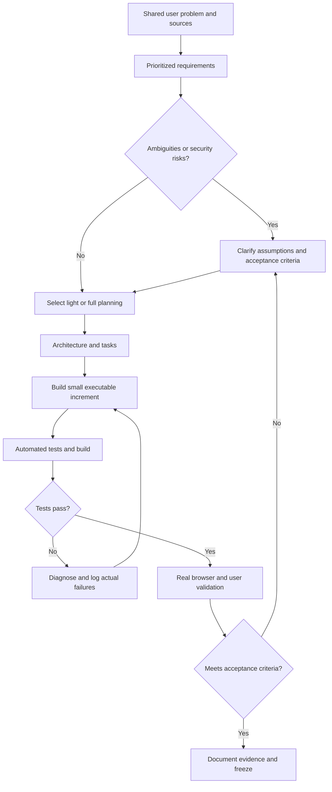

# An Experience Report on a Specification-Driven, AI-Assisted Software Construction Project

**Working draft — requires student review and final real-user test evidence before submission.**  
**Project:** Nordljud, a Swedish-learning web application  
**Course:** Software Construction, Åbo Akademi University  
**Student:** [complete official student/team details]  
**Period:** October 2026  
**Experiment branches:** `condition/vibe`, `condition/god-mode`, `condition/spec-driven`  
**Academic honesty:** AI assistance used for planning, coding, documentation and drafting. Swedish educational content was recovered from earlier user-owned project materials and was **not** independently author-verified.

## Executive Summary (approximately 245 words)

This experience report compares three ways of developing Nordljud, a browser-based Swedish-learning application: iterative vibe coding, autonomous AI-assisted “God Mode” coding, and explicit specification-driven development (SDD) using GitHub Spec Kit. Nordljud supports four language levels, short practical missions, Swedish text-to-speech, a searchable verb collection, user accounts and saved learning progress. The study asks whether a capable coding agent spontaneously produces the engineering structure that a formal specification-first process requires.

To improve comparability, all three implementations began from the same Git commit and used the same recovered educational data. The conditions remained on independent branches, and implementation code was not copied between them. During the first condition, user feedback expanded the scope to include a full verb explorer, favorites, and Google authentication. This change, together with the fixed execution order, limits experimental control and is openly reported.

The vibe-coded implementation reached a publicly accessible pilot and was tested informally by the student. God Mode produced an independent application and autonomous notes and tests, but its initial automated checks failed because a test incorrectly assumed 456 uniquely spelled verbs. Investigation revealed 456 sense records but only 455 distinct spellings. Correcting the test and sense selection led to passing CI. The SDD condition initialized the official Spec Kit CLI, then committed a constitution, specification, clarifications, architecture, tasks and consistency review before application code. Its automated tests, type checking and production build passed. However, Vercel's free-tier deployment quota blocked its live-preview publication.

The evidence suggests that explicit specifications improve traceability and expose assumptions earlier, while autonomous coding can independently produce meaningful engineering practices. Neither successful builds nor a single small case justify a universal ranking. Further browser and two-user authentication tests are required.

---

## 1. Introduction and Paradigm Shift (3 marks)

### 1.1 Motivation and problem statement

AI coding tools increasingly blur the boundaries between specifying a desired product and building it. In a traditional requirements-led project, design and verification artifacts precede implementation. In a vibe-coding conversation, an interactive prototype may appear first and its behavior is refined through observations and follow-up prompts. A strong autonomous coding agent may create an intermediate plan, tests and documentation spontaneously, even when not required to use a formal method.

The Nordljud project asks a practical methodological question: **Which requirements-engineering practices appear voluntarily under an autonomous AI coding prompt, and which become more explicit when a structured specification-first method is imposed?** The intended outcome is an *experience report*, not a statistical experiment.

### 1.2 The product and stakeholders

Nordljud teaches Swedish through English. Its main stakeholder is an adult Swedish learner, initially the student conducting the experiment. The product supports four CEFR sentence-difficulty levels (A2, B1, B2, C1) and four representative situation-based missions. A second mode provides a reusable Swedish verb explorer, searchable by spelling and meaning. A personal learning page tracks question completions and favorites.

The application uses Next.js, React, TypeScript, Supabase Auth/database and browser SpeechSynthesis. The development resources were intentionally constrained to an independent small academic MVP rather than a startup launch.

### 1.3 The three experimental conditions

- **Condition A — Vibe Coding:** iterative prompts, browser observations and user-directed defect corrections.
- **Condition B — God Mode:** a strong master prompt assigning the agent responsibility for implementation and allowing it to decide whether to plan, document, test or verify. No named specification method is forced or prohibited.
- **Condition C — SDD:** explicit methodology using **GitHub Spec Kit v1.1.3**, a constitution, prioritized requirements, clarification, architectural plan, task decomposition, consistency analysis, implementation and convergence reporting.

A common baseline commit `1afd635324a788f18db19f83f338ad89ade54e33` contained the same educational JSON data and product brief before the method-specific code was written. The source content was a preexisting user-owned asset; reusing the *data* is disclosed, while copying historical application code between methods was prohibited.

### 1.4 Research hypothesis and constraints

An exploratory hypothesis was that strong agentic instructions might cause the agent to create some SDD-like practices on its own. An alternative was that mandatory specifications would improve traceability and verification despite greater process overhead. Only one developer, one application and a fixed A→B→C sequence were observed. No general causal inference is justified.

## 2. Requirements and System Specification (6 marks)

### 2.1 Scope and changes

The original common product brief required four levels, one mission per level, source-based Swedish and English examples, Swedish speech, a comprehension exercise, a verb-form exercise and saved progress. **After A began**, the student requested an expanded verb explorer and account flow. This change was recorded on coordinating `main` in `research-evidence/SCOPE_CHANGE_01.md`, rather than retroactively written into the frozen starting state. B and C received the expanded goal as a dated common change.

The initial claim of “456 verbs” needed special clarification. Every level contains **456 sense records but 455 distinct written lemmas**, because `sticka` is used twice for different senses: knitting (`stickar`) and stinging/leaving (`sticker`). C explicitly identified this domain distinction in its specification before implementation; B discovered it after a CI assertion failed.

### 2.2 Stakeholders, functional and nonfunctional requirements

Stakeholders include language learners, the course assessor, and the developer maintaining the experiment. Key functional requirements: level selection, four missions, exact source sentences, English help, Swedish audio, two checked questions per mission, 456 browsable sense records per level, persistent favorites, email and Google identity, individual progress and account separation.

Nonfunctional requirements included source-data integrity, accessible controls, mobile presentation, honest error feedback, no elevated browser credentials and repeatability of the experiment. Performance targets were deliberately modest: fetch a selected level on demand rather than send every source record to the initial browser.

### 2.3 SDD requirements traceability

Condition C contains 20 numbered requirements (FR-001–FR-020), four prioritized, independently testable user stories, concrete Given/When/Then acceptance criteria and 10 ambiguity resolutions. A documented analysis connects each requirement to an architecture decision, API contract and T001–T020 implementation task.

Relevant project files:
- `condition/spec-driven:.specify/memory/constitution.md`
- `condition/spec-driven:specs/001-nordljud-classroom/spec.md`
- `condition/spec-driven:specs/001-nordljud-classroom/clarifications.md`
- `condition/spec-driven:specs/001-nordljud-classroom/plan.md`
- `condition/spec-driven:specs/001-nordljud-classroom/data-model.md`
- `condition/spec-driven:specs/001-nordljud-classroom/contracts/lexicon-api.md`
- `condition/spec-driven:specs/001-nordljud-classroom/tasks.md`

### 2.4 Architecture

The application serves static teaching data from immutable JSON sources through a Next.js route. Browser components show the mission or lexicon, request speech from the local system and collect responses. Supabase Auth supplies Google or email identity, and an existing `public.learner_states` table stores account-specific JSONB progress and favorites. RLS policies permit a signed-in user to read/write rows only when `auth.uid() = user_id`. Each condition uses a different JSONB namespace to avoid overwriting the historic application or other experiments. Guest state stays in local browser storage.

The SDD architecture diagram appears in `plan.md`. **Add a screenshot of this diagram in the final report.**

## 3. Vibe Coding: Implementation Experience (5 marks)

### 3.1 Method and actual iterations

Condition A began by constructing a basic Swedish lesson flow through human–AI dialogue and GitHub commits. The student then reviewed deployed screens and requested changes. The application evolved to three navigable sections — Today/Missions, Explore/Verb Library and My Learning — with source-driven verbs, audio, favorites and accounts.

The archived Vibe log in `condition/vibe:01-vibe-coding/vibe-log.md` documents genuine corrections, including:
- The first deployment pointed at repository `main`, which had no Next.js application, causing a “No Next.js version detected” failure.
- Browser Swedish audio initially did not work. The code was amended to handle delayed `voiceschanged` and explain missing local voice support. The student later reported that audio was working.
- Changing difficulty sometimes changed the selected verb. A level-change handler forcibly reset the word to `arbeta`; the agent changed selection logic and added a regression test.
- Google Sign-in was initially blocked by a disabled Supabase provider and missing external Google OAuth credentials. The student configured the Google Cloud OAuth client and enabled the Supabase provider, later confirming login functioned.

### 3.2 Deployment and user pilot

The Vibe branch was deployed successfully to Vercel. The stable public classroom pilot was eventually published as **https://nordljud.vercel.app**, with Vercel Production open to visitors and previews still protected. The Supabase Google redirect allowlist required the new origin. The student reported the application worked. Further two-account privacy and durable-progress testing needs separate evidence; merely sharing the URL does not prove those acceptance tests.

### 3.3 Costs and insights

The Vibe implementation produced quick interactive feedback but required multiple corrections triggered by a human observing a real browser. Its scope expanded mid-run, and feedback cycles cannot be treated as evidence of incompetence: discovery of genuine usability problems is a valid part of development. The final Vibe code is documented through **36 commits** relative to the frozen baseline (measurement captured 13 October). Without reliable instrumented timestamps, the time spent cannot be compared quantitatively.

## 4. Specification-Driven Development Experience (7 marks)

### 4.1 Authentic toolkit initialization

To avoid presenting ordinary Markdown documents as an official toolkit run, the project installed **GitHub Spec Kit v1.1.3** through GitHub Actions:

`uvx --from specify-cli==1.1.3 specify init --here --force --non-interactive --integration copilot --ignore-agent-tools --script sh`

Workflow **38319369671** completed successfully, checked in `.specify` scripts/templates/memory and Copilot skills, and recorded the installed integration in `.specify/integration.json`.

**Critical method disclosure:** The CLI was truly executed, and the developer then produced the SDD documents following the installed templates and workflow stages. The evidence does **not** establish that a separate Copilot chat agent literally invoked every `/speckit-*` slash command. Distinguish toolkit initialization from artifact authorship.

### 4.2 The actual sequence

1. Ratify a constitution: source fidelity, security, testable stories, independent implementations and scope limits.
2. **Specify:** commit prioritized stories, 20 functional requirements and Given/When/Then acceptance.
3. **Clarify:** commit ten domain decisions including 456 sense records/455 spellings, guest/account behavior and the dual `sticka` meanings.
4. **Plan:** commit research choices, TypeScript/Next/Supabase architecture, teaching model, API contract and quickstart.
5. **Tasks:** create 20 path-specific implementable work items.
6. **Analyze:** check specification, design and task coverage before writing application source.
7. **Implement:** build an independent React/Next learner interface, mission derivation, CEFR lexicon, user sign-in, favorites and personal state.
8. **Converge:** report CI results and the unfinished live acceptance tests.

All design artifacts were committed **before** application scaffolding/code was created. The same shared teaching datasets were used, but A or B application code was not copied.

### 4.3 Implementation outcome and constraints

SDD GitHub Actions workflow **38320127745** completed successfully: **4/4 source tests**, strict TypeScript check and optimized Next.js production build. The test suite checked source quantities, two `sticka` senses, cross-level identity stability, four mission seeds and missing form examples.

A separate Vercel project `nordljud-sdd-lab` was created and its preview Supabase public environment configured. An actual deployment attempt returned **HTTP 402**, `api-deployments-free-per-day`, due to the free-plan API deployment limit (over 100 per day). This was a hosting quota blocker, not a Next.js compilation failure. SDD did **not** reach a live browser acceptance demonstration at the time of this draft. The convergence verdict is **PARTIAL / NOT YET CONVERGED**.

## 5. Verification and Validation (6 marks)

### 5.1 Shared evaluator and test evidence

The common test checklist `main:evaluation/TEST_PLAN.md` was prepared before implementations. It contains F01–F14: email registration, login/reload/logout, four levels and missions, exact examples, Swedish speech, two exercise types, persisted progress, cross-user isolation, mobile usability, build, missing example handling and secret safety. The expanded explorer/favorites/Google requirements must also be assessed fairly.

**Differentiate levels of evidence**:
- CI source tests assert defined data invariants and commands.
- TypeScript and production builds prove that a particular source snapshot compiles.
- Vercel READY verifies a deployment build, not successful OAuth or mobile behavior.
- The student's informal review confirms a limited human UI observation, not a comprehensive test run.
- Real user A/B data isolation requires separate accounts and interactive verification, which is not yet evidenced.

### 5.2 Actual verification results at current freeze

| Evidence item | A: Vibe | B: God Mode | C: SDD |
|---|---|---|---|
| Application source code | implemented | implemented independently | implemented independently |
| Git history vs baseline | 36 commits | 21 commits | 31 commits |
| Vercel build | READY, public pilot | READY preview; later fixes CI-checked | BLOCKED by API quota |
| Automated CI | selective regression assertions in source; full GitHub CI record not yet verified | initial **FAIL**, later **PASS** | **PASS** |
| TypeScript/build CI | not independently confirmed for frozen A in this report | passing in workflow `38319216764` | passing in workflow `38320127745` |
| Source test counts | must verify | 3/3 after correction | 4/4 |
| Swedish audio | student reported working | implementation exists; unverified on device | implementation exists; unverified on device |
| Google sign-in | student reported enabled and working | needs callback/preview allowlist and test | needs deployment and callback test |
| User progress survives login | code exists; external verification incomplete | code exists; external verification incomplete | code exists; external verification incomplete |
| Two-account data isolation | RLS policies reviewed, browser test pending | RLS policies reviewed, browser test pending | RLS policies reviewed, browser test pending |
| Source data integrity | shared data reused | 456/455 ambiguity exposed by failed test | explicitly required before coding |

The final per-test acceptance matrix must be filled only after the student tests each method. Unsupported cells remain **NOT TESTED** rather than falsely marked PASS.

### 5.3 Defects and validation reasoning

A notable concrete failure was **B's initial false assertion** that the number of sense records equals the number of uniquely spelled lemmas: `455 !== 456`. After identifying two meanings of `sticka`, the God Mode agent corrected the test and made lexicon selection/favorites distinguish senses by both lemma and meaning. Workflow `38319216764` then passed. C had made the distinction explicit in its specification, avoiding the same assumption *in the test design*.

This is a useful example of the difference between detecting errors via tests and preventing a flawed test requirement through earlier specification. One case, however, cannot establish which method will outperform across other projects.

### 5.4 Pending tests

For A and B, manually test two separate signed-in accounts, reload and re-login retention, a correct answer, a favorite, ability to remove a favorite, mobile viewport and Google redirect. For C, first wait for deployment quota and then run the same sequence. Archive screenshots/logs and record environment, date, feature and relevant Git SHA.

## 6. Project Management, AI Toolchains, and Git (3 marks)

### 6.1 Repository and isolation

Private GitHub repository: `alikhalessi/nordljud-software-construction`. The `baseline-v1` branch is frozen. The three condition branches were created from `1afd635324a788f18db19f83f338ad89ade54e33`. Condition C additionally uses `specs/001-nordljud-classroom` and official `.specify` tooling.

A snapshot branch `checkpoint/vibe-2026-10-13` preserves the first method at the relevant phase. Vibe is publicly hosted but that public sharing was a post-development infrastructure action, not a new experimental starting point. Condition B has a logged autonomous master prompt and decision record. Condition C has a full traceability chain from requirements to tasks.

### 6.2 AI assistance and human roles

The student selected the product, supplied historic teaching data and priorities, visually reviewed the implementations, reported usability defects, and completed Google/Supabase provider configuration. The assistant contributed code, repository updates, automated test scaffolds, project configuration, failure investigation, documentation and this draft report.

Explicit user authorizations and corrections were recorded. The assistant's internal choices must not be misrepresented as the student's verbatim interview answers. Generated documentation is evidence of process only when the timing and commit history support its actual creation.

### 6.3 Process metric limitations

Commits and file counts were retrieved from GitHub compare results, but raw commit totals do not directly measure productivity or quality. Execution time was not reliably instrumented and must **not** be invented. The shared static dataset is inherited, so raw file/line counts also misrepresent the amount of implementation.

## 7. Reflections and Proposed Process (5 marks)

### 7.1 Main observations

**Vibe Coding** delivered feedback quickly through an early visible prototype. Its weakness was late discovery of assumptions through browser use; however, active learner feedback also surfaced meaningful UX defects that abstract requirements may overlook.

**God Mode** independently produced application modules, notes, tests and deployment automation. The first dataset test failed, showing that an autonomous agent can create a detailed but **incorrect assumption**. The agent later learned from actual failure and fixed both a test and a related word-selection identity issue.

**Explicit SDD** required more artifacts and preimplementation discipline. It documented a double-meaning homograph before the first application file and made each of 20 requirements traceable to a task. This is good evidence for requirements clarity and auditability, not conclusive evidence of higher delivered functional quality. Its live deployment was limited by an unrelated quota.

### 7.2 An evidence-aware comparison

The results **support a descriptive conclusion**, not “SDD always wins” or “God Mode makes SDD obsolete.” Autonomous coding can generate some good practices spontaneously, but formal SDD makes criteria and ambiguity resolution explicit and inspectable in advance. Its additional documentation costs may be justified when requirements are ambiguous, security-sensitive or independently assessed. For a tiny classroom MVP, the amount of specification could be considered overhead.

The comparison is confounded by requirement expansion during A, successive human/AI learning across conditions, different deployment situations, and incomplete browser authentication testing. The responsible final conclusion should keep these limitations prominent.

### 7.3 Proposed reusable AI-assisted construction process

I propose a **risk-calibrated hybrid**: apply a minimal explicit spec for short, reversible features; expand the spec and tests for authentication, user privacy and ambiguous domain terms; use iterative UI feedback in both cases. AI agents may execute many steps, but humans should retain responsibility for product goals, account provisioning and accurate final sign-off.

### 7.4 Remaining work before submission

- **Do not submit this draft as final yet.** Collect real manual acceptance screenshots and complete the F01–F14 matrix for all three conditions.
- Once Vercel permits deployments, host SDD on its separate project and validate actual login, progress and data isolation.
- If Google preview login in God Mode or SDD is needed, add specific redirect origins in Supabase; do not expose Google Client Secret.
- Add student/team information and check the **current Moodle assignment wording** and institutional AI-use policy. The course alignment sheet is based on earlier supplied instructions and was not rechecked against Moodle at report-drafting time.
- Document actual dates/times only where Git evidence supports them. Include at least one figure of each UI, the SDD architecture diagram, actual CI run links, and the proposed process figure.
- Proofread the student's first-person reflections and verify each personal experience claim before submission.

## Primary Evidence and Links

- Repository: https://github.com/alikhalessi/nordljud-software-construction
- Vibe deployed pilot: https://nordljud.vercel.app
- God Mode CI failed: https://github.com/alikhalessi/nordljud-software-construction/actions/runs/38317088266
- God Mode CI passed: https://github.com/alikhalessi/nordljud-software-construction/actions/runs/38319216764
- SDD real Spec Kit initialization: https://github.com/alikhalessi/nordljud-software-construction/actions/runs/38319369671
- SDD CI passed: https://github.com/alikhalessi/nordljud-software-construction/actions/runs/38320127745
- Spec Kit official source and workflow: https://github.com/github/spec-kit
- SDD convergence assessment: `condition/spec-driven:specs/001-nordljud-classroom/converge.md`
- Common evaluation: `main:evaluation/TEST_PLAN.md`
- Source recovery/provenance: `baseline-v1:shared-content/SOURCE_MANIFEST.md`

**Status:** Evidence-based draft; human submission review and final verification pending. Do not imply this is the user's fully reviewed final report.

---

## Post-release empirical finding — SDD Login discoverability (13 October 2026)

**New learner observation:** After viewing the first hosted Spec-Driven edition, the student reported that no Login section appeared to be present and questioned whether a complete specification should have prevented that problem on the first implementation. This is a substantive outcome for the comparative study, not a cosmetic complaint to conceal.

**Source-code analysis:** The original SDD's `app/experience.tsx` actually contained email/password and Google OAuth functions and a login form, but these appeared only after clicking **My learning**. The top-level account button displayed **Guest learner** rather than the explicit action **Sign in**. The original FR-012/FR-013 specified available account methods but did not specify visible entry from the landing screen or one-click navigation to login. The prior automated tests checked the learning source data, TypeScript and Next.js compilation; they never tested whether a new learner could discover sign-in.

**Pre-fix RED reproducible evidence:** A post-release specification amendment `CR-SDD-02` added FR-021 and SC-009, requiring an explicit accessible Sign in button immediately visible on desktop and mobile, opening the account form within one click. Before correcting UI, GitHub Actions [run 38376988433](https://github.com/alikhalessi/nordljud-software-construction/actions/runs/38376988433) installed Chromium and Playwright, then failed **2/2** browser tests: no Sign in button could be found on either initial screen. The old successful builds were therefore insufficient as user-acceptance evidence.

**Post-fix GREEN evidence:** The SDD interface was minimally revised to show Sign in in the header plus a learning-progress sign-in CTA, while preserving the existing account form and third-party auth logic. The *same* two browser checks plus a third regression check of My learning passed **3/3** in GitHub Actions [run 38377362037](https://github.com/alikhalessi/nordljud-software-construction/actions/runs/38377362037). The standard source/type/build CI also passed [run 38377362015](https://github.com/alikhalessi/nordljud-software-construction/actions/runs/38377362015). Fixed UI code commit: `898b72b76ba720c6403ec30e114fa5351648a2c7`. Vercel Production deployment `dpl_7Gz2rhpsGZmrVPBaqNrpPTHMj1A8` confirmed **READY** with stable URL [nordljud-sdd-lab.vercel.app](https://nordljud-sdd-lab.vercel.app).

**Scientific interpretation:** There is no evidence that SDD inherently means “the agent fully and correctly completes everything on the first try.” Specification-first engineering provides a process for writing requirements, tracing implementation, evaluating acceptance, and converging through corrections. The initial specification omitted a consequential usability criterion; the first-pass tests did not exercise the learner journey; and a perfectly compiling program can still fail that experience. That is a failure of specification **completeness** and validation **coverage** within this SDD case. It is not an absence of auth code, nor proof that actual Google OAuth worked. The experiment also used the official Spec Kit CLI scaffold but assistant-written spec/plan/task stages, not full executed Copilot slash commands; the report must keep this qualification.

**Unresolved:** Real Google sign-in, account persistence, two-user RLS isolation and learner-specific cloud storage remain **NOT TESTED** on the updated SDD deployment. A Google auth return URL may have to be added to the Supabase redirect allowlist by the owner. A READY build is not a real-user OAuth result.

**Direct research artifact:** [Condition C's documented, dated first-pass failure and red/green fix](https://github.com/alikhalessi/nordljud-software-construction/blob/condition/spec-driven/specs/001-nordljud-classroom/DEFECT_001_HIDDEN_LOGIN.md). This appendix does not overwrite or retroactively rewrite the older report's frozen-phase findings.

---

## Post-release finding 2 — Google OAuth redirects to localhost in SDD (13 October 2026)

After the previously reported hidden Login button was fixed and Chromium checks passed, the student attempted **a real Google account selection** on the hosted SDD page. They observed Google's account chooser, but after choosing their account the browser navigated to `localhost:3000`. Thus **Google OAuth end-to-end is currently FAILED by user observation**; it should no longer be labeled merely NOT TESTED or implied to work because the Google button is clickable. The independent source-data/type/build CI and UI-discoverability tests remain green, but they do not cover this external integration.

Code inspection confirmed the SDD client uses `signInWithOAuth({ provider: "google", options: { redirectTo: window.location.origin + "/" } })`. Production/Preview Supabase public environment variables are present. Official Supabase troubleshooting documents that a `redirectTo` target not in Authentication's allowed Redirect URLs may cause fallback to the Site URL (often `http://localhost:3000`). The current Supabase project allowlist/Site URL could not be read or altered through connected tools, so this remains a **high-confidence diagnostic hypothesis** until owner verification.

The narrowly scoped repair is to allow the SDD hosted origin `https://nordljud-sdd-lab.vercel.app/` in Supabase Auth URL Configuration and retest Google callback, then progress and favorites across sign-out/re-login. The shared Supabase Site URL and existing Vibe redirects must not be overwritten. This is a **second distinct SDD failure category**: the first defect was login **discoverability**, the second is **environment-specific OAuth integration**. Both reveal why written specifications and green builds are insufficient without realistic acceptance checks. Keep external configuration dependencies explicit.

Evidence: `condition/spec-driven:specs/001-nordljud-classroom/DEFECT_002_GOOGLE_OAUTH_LOCALHOST_REDIRECT.md`. Exact OAuth browser/network trace and successful re-test remain pending.

---

## Post-defect user verification — SDD Google OAuth and saved state now work (13 October 2026)

**Chronological update (does not erase initial failure):** Following the previously documented Google OAuth redirection to `localhost:3000`, and after receiving Supabase Redirect URLs configuration guidance, the student independently retried SDD. The student reports that Google login now works, and that saved information remains after sign-out and re-login. This is a **PASS (student-observed)** for real Google sign-in/callback and for restoration of at least some same-user data. It **supersedes** the earlier observation of currently failing Google login, while preserving the original failure as essential empirical evidence of the debugging loop.

The precise Supabase URL allowlist value was not independently retrieved, so the hypothesized configuration cause is strongly supported but not definitively established from a dashboard capture. The student's report does not specify whether *both partial/completed* mission flags and Favorites separately survived re-login. A **second independent Google account** has not yet been tested for data isolation; F10 remains **NOT TESTED**. Email/password invalid-login, all four mission levels, cross-device behavior and full F01–F14 acceptance remain open.

**Primary evidence:** `main:evaluation/SDD_USER_ACCEPTANCE_2026-10-13.md`; `condition/spec-driven:specs/001-nordljud-classroom/DEFECT_002_GOOGLE_OAUTH_LOCALHOST_REDIRECT.md`; user report in current conversation. No tokens, user emails or private personal learning state were copied into repository.

**Interpretation:** The two SDD defects (auth entry discoverability and hosted OAuth callback) illustrate important gaps between written criteria, code/test success and operational acceptance. Recovering from both through explicit documented verification steps is part of the method's *convergence process*, not evidence of perfect first-pass generation.
