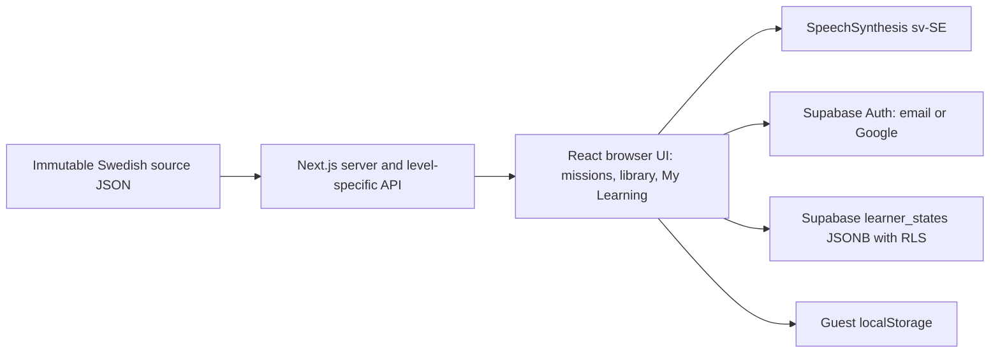
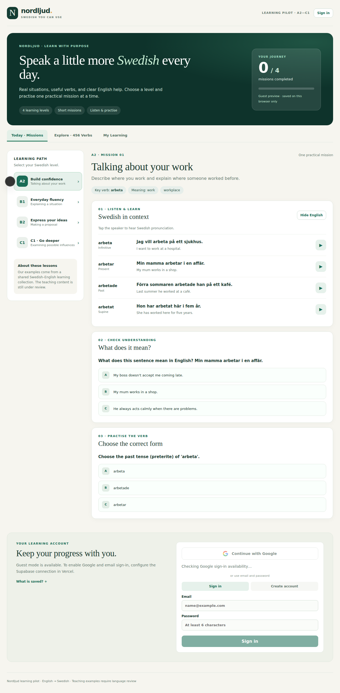
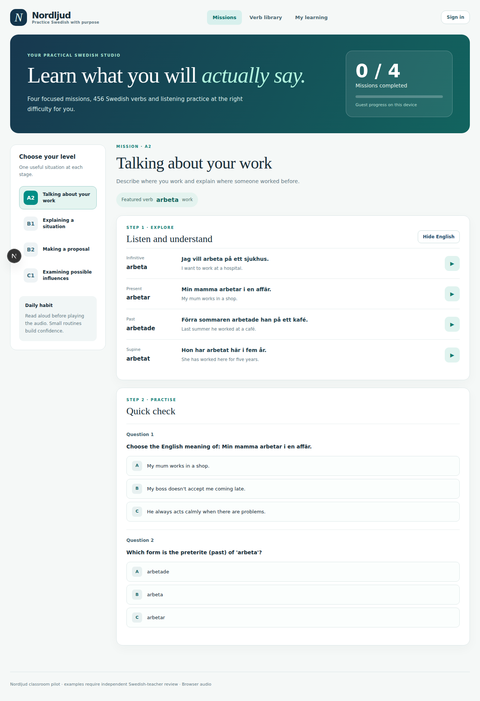
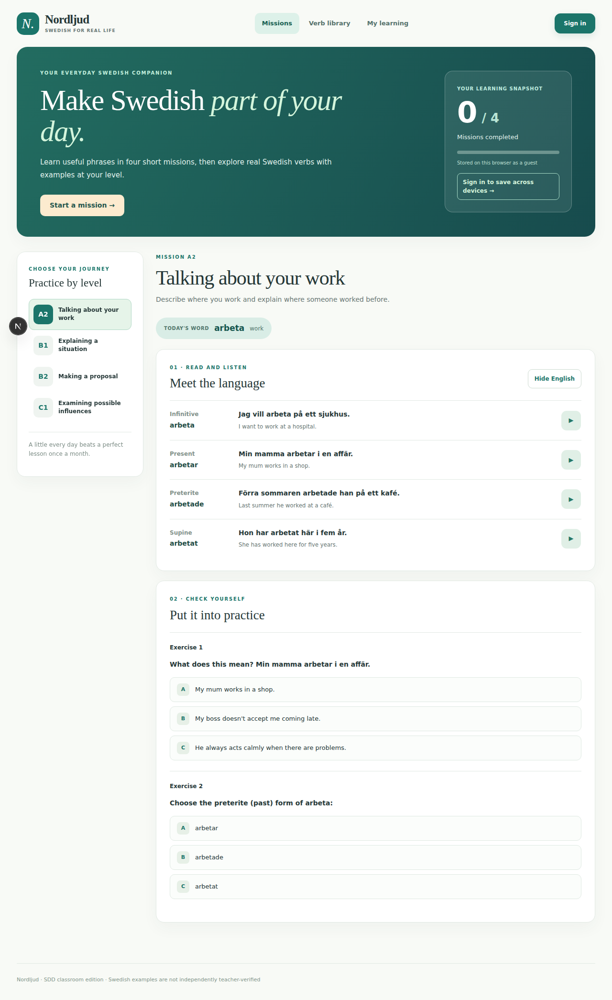
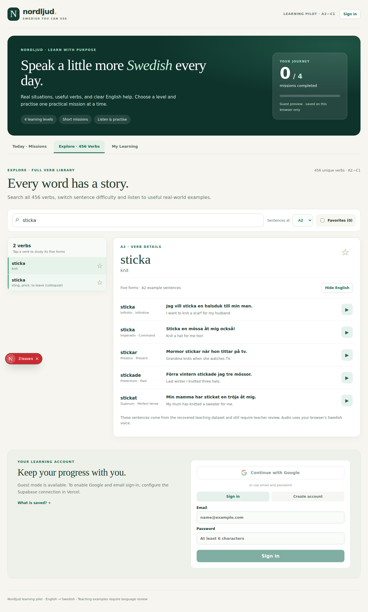
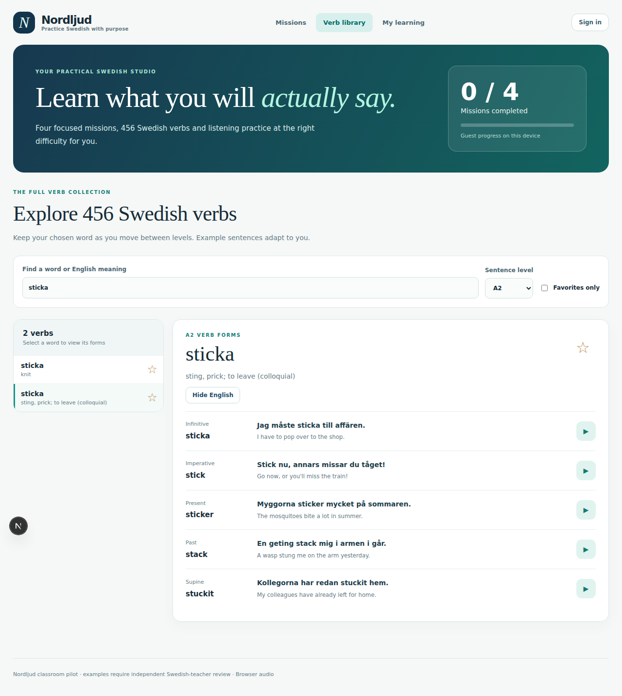
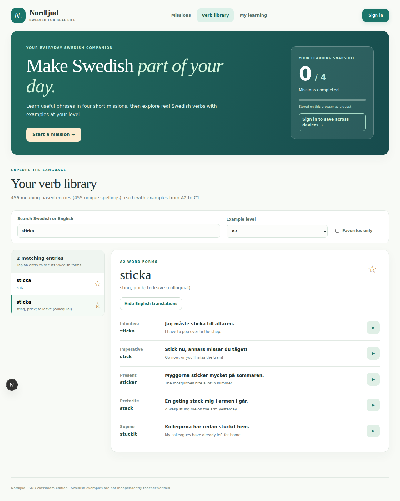
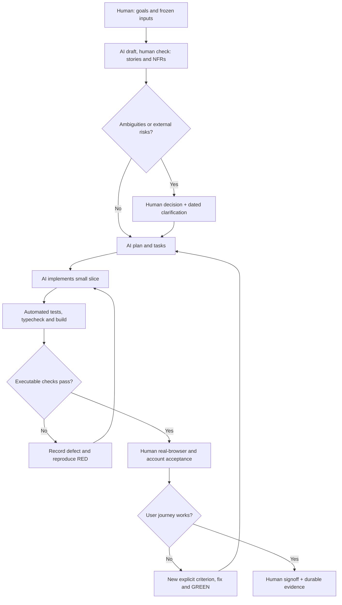

# An Experience Report on a Specification-Driven, AI-Assisted Software Construction Project

**Evidence-based report revision — 14 October 2026**  
**Project:** Nordljud — mission-based Swedish-learning application  
**Course:** Software Construction, Åbo Akademi University  
**Student:** Ali Khalessi  
**Student contributors:** 1 (individual project)  

**Team Details (individual project):** Ali Khalessi — Student ID: **pending confirmation** — Role: sole student, product owner, requirements decisions, human acceptance and academic submission — Student participation: **100%**. I have confirmed that this individual submission has already been approved; the approval date and written record have not been supplied for independent documentation. This participation percentage does not imply personally typing all AI-generated code.  
**Study design:** Three AI-assisted construction approaches sharing frozen educational input; independent application code in separate Git branches.  

## Executive Summary (200–300 words)

Using OpenAI ChatGPT with **GPT-6 at High thinking effort** (my retrospective model-setting confirmation), I developed Nordljud, a Swedish-learning web application, in three separate ways to explore how AI-assisted programming changes when the working method changes. Condition A used iterative Vibe Coding: I examined intermediate screens, found problems, and requested corrections. Condition B used a broad autonomous “God Mode” instruction that let the agent choose its own engineering practices. Condition C used explicit Specification-Driven Development (SDD), with the official GitHub Spec Kit scaffold, formal requirements, clarification, architecture and tasks before implementation.

Each implementation began from the same frozen Git baseline and reused the same recovered Swedish-language dataset, while application code remained separate. A subsequent request expanded the scope during the first condition, so the comparison is descriptive rather than a controlled experiment.

Independent CI found that all three applications passed TypeScript and production compilation. Vibe’s frozen data tests failed four assertions because they incorrectly assumed 456 uniquely spelled verbs, although the input contains 456 sense records and 455 distinct spellings. God Mode initially made the same assumption, then corrected its tests and user interface. SDD captured that distinction during clarification. A separate Chromium comparison demonstrated another concrete difference: Vibe could not select the second meaning of `sticka`, whereas God Mode and SDD could.

However, SDD itself was not perfect on its first deployment. Login was difficult to find, and a real Google sign-in initially redirected to localhost. Both issues were documented and subsequently corrected; I tested and reported working authentication, retained data and a successful two-account check.

The evidence favors explicit requirements and real acceptance tests for traceability, not an unconditional claim that one AI method always wins. The strongest practical lesson is to combine fast feedback, clear specifications and independently verified behavior.

---

## 1. Introduction and Paradigm Shift (3 marks)

### 1.1 Project Overview & Objectives

Nordljud is my Swedish-learning classroom MVP for adults. Its four levels (A2, B1, B2, C1) feature representative learning missions, a searchable verb library, Swedish browser speech, English assistance, short exercises and personal learning progress. I built it as a real software-construction experiment, not a teacher-certified Swedish curriculum or a finished commercial product.

I compared (A) iterative Vibe Coding, (B) an autonomous agent following a strong master prompt (God Mode), and (C) explicit Specification-Driven Development (SDD) using GitHub Spec Kit. My question was: **Which engineering practices does a powerful AI coding agent adopt on its own, and what added traceability comes from specifications imposed before code?** Each implementation began from the identical frozen educational baseline and was written in a separate Git branch without copying application code between conditions.

The comparison uses real Git commits, source tests, TypeScript, production builds, common Chromium guest-browser tests and limited manual acceptance. The scope expanded during A, and my later AI interactions already knew about earlier defects, so this is a descriptive experience report rather than a randomized controlled experiment.

### 1.2 The Vibe Coding

My technique was **iterative natural-language prompting of an AI coding agent through connected GitHub/Vercel/Supabase workflows**. I described what the learner should experience, inspected what had actually run, and gave focused follow-up instructions when the interface or integration failed. I did not require a complete SRS, formal task breakdown or separate pre-code quality gate for A.

That flexibility made it easy to show a working prototype and incorporate my feedback about speech, level switching, the full lexicon and Google login. However, a domain ambiguity survived: the Vibe code keyed a selected Swedish verb by spelling only. Two `sticka` records have different meanings; one guest-browser assertion later failed because selecting the second still displayed the first meaning. This is evidence about the actual implementation and testing, not a claim that every iterative process fails.

### 1.3 The SDD Methodology

I chose **GitHub Spec Kit** because it gave me an inspectable path from a product brief to versioned user stories and Given/When/Then acceptance criteria, FR/NFR lists, clarification decisions, architecture, an API contract, ordered tasks, analysis, implementation and convergence. The Spec Kit v1.1.3 CLI **really ran**. ChatGPT then generated the actual process artifacts following its templates. Its `--integration copilot` option created compatible tooling, but did not by itself prove GitHub Copilot executed the `/speckit-*` commands.

The clarify stage distinguished 456 sense records from 455 uniquely spelled verbs before C application code was committed. Nevertheless, the first C release did not make Sign in easy to discover, and a real Google OAuth attempt redirected to localhost. I recorded both problems and tested the later corrections rather than presenting SDD as perfect on the first pass.

**Brief timeline:** I froze the common baseline on 12 October 2026, developed A and documented its scope expansion, then built B and C from independent branches; C's specification documents preceded its application code. During 13 October I tested and corrected real auth defects. On 14 October I preserved independent A/B/C tests, browser screenshots and the comparative report. Git timestamps establish the order of commits, not how long I or the AI was actively working.

## 2. Requirements and System Specification (6 marks)

### 2.1 Stakeholders and their rationale

| Stakeholder | Relevance to Nordljud | Evidence or boundary |
|---|---|---|
| **Me — Ali Khalessi (sole student and product owner)** | I chose the Swedish-learning goal, supplied/recovered teaching data, adjusted priorities, configured accounts and inspected live applications. | Direct requests, Git history and my manual feedback; no fictional team meetings. |
| **Adult Swedish learner (primary end user)** | Needs readable Swedish examples, helpful English and speech, reliable question feedback, discoverable sign-in and persistent progress. | Represented by practical mission stories and my manual learning tests; not a separately recruited user study. |
| **Course instructor / assessor** | Needs reproducible evidence of process, prompts, requirements, version control, defects and validation. | Course rubric summary and independent GitHub evidence. Actual instructor access to the private repository remains to be arranged. |
| **Learning-content steward** | Requires recovery provenance, immutable shared datasets and clear disclosure that sentence quality is not teacher-certified. | `shared-content/SOURCE_MANIFEST.md` and frozen educational inputs. |
| **Identity/data provider (Supabase and Google)** | External dependencies constrain OAuth redirects and user-specific data. Not members of the development team. | Supabase browser integration, RLS policy inspection and the real localhost return problem. |

These are stakeholder **roles relevant to requirements**, not five interviewed or actively participating people. I did not carry out a formal stakeholder interview study.

### 2.2 Functional requirements — original specification and dated amendment

The following requirements reproduce the numbering and wording of the **actual SDD source specification**, rather than inventing a new list after implementation. `FR-001`–`FR-020` were recorded before application source. **FR-021 was added after the first SDD release**, in response to my observation that login was hidden under My Learning; it must not be counted as pre-code foresight.

| ID | Requirement from `condition/spec-driven:specs/001-nordljud-classroom/spec.md` |
|---|---|
| FR-001 | Show A2, B1, B2 and C1 learner levels. |
| FR-002 | Offer exactly one representative mission per level, using unchanged shared mission seeds. |
| FR-003 | Display source Swedish example sentences and corresponding English meaning or translation. |
| FR-004 | Let the learner show/hide English assistance. |
| FR-005 | Request a Swedish voice (`sv-SE`) when audio is played, and show a useful status if unavailable. |
| FR-006 | Provide an English meaning comprehension question with correctness feedback. |
| FR-007 | Provide a Swedish verb-form question with correctness feedback; no credit for incorrect answers. |
| FR-008 | Offer searchable browsing across **456 sense records / 455 written lemmas** at each CEFR level, including both `sticka` senses. |
| FR-009 | Preserve the same selected sense across changes in example difficulty. |
| FR-010 | Show all five source word forms; unavailable examples must be explicitly unavailable. |
| FR-011 | Let the learner mark/unmark favorite sense records and review them in My Learning. |
| FR-012 | Offer email/password account creation, sign-in and sign-out. |
| FR-013 | Offer Google OAuth sign-in, with a graceful error if the externally configured provider is unavailable. |
| FR-014 | Save signed-in learner progress and favorites, and restore them after reload/re-login. |
| FR-015 | Enforce access isolation so one learner cannot access another learner's saved activity. |
| FR-016 | Allow guest study on one browser and disclose that guest work is not automatically merged into an account. |
| FR-017 | Display actionable errors for save failures, missing resources, invalid login and missing audio. |
| FR-018 | Work at desktop and narrow mobile widths with keyboard-accessible interactive controls. |
| FR-019 | Never expose elevated Supabase credentials in user-visible assets or source control. |
| FR-020 | Do not modify pre-existing Nordlyd deployments, study data, or experiments A/B. |
| FR-021 | On the initial study view, a signed-out learner MUST see a prominent, keyboard-accessible, plainly labeled **Sign in** control without first opening `My learning`. Selecting it MUST present both the Google login option and email/password sign-in controls **with one interaction**. Signed-in users should instead see recognizable account access. |

**Priorities and traceability:** User Stories 1–2 (missions and verb explorer) are P1; Stories 3–4 (accounts and personal storage) are P2 in the original spec. Given/When/Then criteria and edge cases are in the preserved source specification. The defect-triggered **FR-021** adds the P1 discoverability check and links to Playwright RED/GREEN evidence. The common evaluation cases `F01–F14` were written before implementations; the expanded `G01–G05` checks were recorded separately to avoid rewriting the baseline after A began.

### 2.3 Non-functional requirements and measurable acceptance

The earlier spec has quality constraints but no comprehensive numerical NFR catalogue. The tests/criteria below **operationalize the recorded constraints for the report**. Where a threshold was not originally preregistered, it is explicitly a **retrospective proposed check**, not a claim it was met.

| NFR | Quality attribute / measurable rule | Method of measurement | Evidence status |
|---|---|---|---|
| NFR-01 | **Source integrity:** exactly 456 source sense records per CEFR level; 455 distinct spellings; two `sticka` senses remain. | Deterministic Node source tests + browser selection of both senses. | A uniqueness test FAIL and A sense selection FAIL; B/C corrected/passed selected checks. |
| NFR-02 | **Correctness/buildability:** strict TypeScript, source tests and successful Next.js production build must be reported separately. | Shared CI job on each frozen branch (same Node 22 runner). | All builds/type checks PASS; original A source tests 7/11, B 3/3, C 4/4. |
| NFR-03 | **Per-account privacy:** authenticated SELECT, INSERT, UPDATE and DELETE of `learner_states` require `auth.uid()=user_id`; two accounts do not see each other's UI state. | Read-only PostgreSQL RLS inspection; two-account manual scenario. | RLS configuration confirmed; two-account SDD acceptance reported by me; no adversarial API test. |
| NFR-04 | **Auth findability:** visible accessible `Sign in` on first screen at desktop and **390 px** mobile viewport, with both login methods reachable in one click. | Chromium Playwright assertions. | SDD initial FAIL 2/2 → revised PASS 3/3; requirement added post-release. |
| NFR-05 | **Swedish audio:** request `sv-SE`; when device/browser lacks a Swedish voice, show an actionable notification instead of silent success. | Browser voice/API simulation and physical Swedish voice check. | Implementation reviewed; limited Vibe user feedback; all-device audio NOT TESTED. |
| NFR-06 | **Guest persistence:** two A2 question-completion flags still appear after refresh in the same guest browser. | Independent Playwright guest browser check. | A/B/C PASS on this narrowly defined test. |
| NFR-07 | **Security of client builds:** no elevated Supabase service-role credential in web-delivered source; browser uses public publishable key only. | Review environment variable names, source and built client. | Browser code inspected; comprehensive history-wide secret scan not performed here. |
| NFR-08 | **Responsive usability (proposed full check):** no horizontal overflow at 390 px width, interactive controls reachable by keyboard, readable mission content. | Screen-size and keyboard E2E checklist. | Login entry test PASS in C; full cross-method mobile audit NOT TESTED. |
| NFR-09 | **Performance (proposed target):** first interactive screen ≤ 3 seconds on a defined reference device/network; lexicon request retrieves only one level (456 records), not all four. | Browser performance trace and network payload audit on fixed device/network; selected-level response contract. | Architecture and route verified in C; **three-second target NOT MEASURED**, not a reported result. |
| NFR-10 | **Reproducibility:** identical frozen data input and independently buildable branch per method with commit SHA and test logs. | Git branch and CI artifact checks. | Demonstrated for A/B/C; human/model total time not instrumented. |

### 2.4 Development tools, versions, selection rationale and AI attribution

| Technology or tool | Version/role evidenced by repo | Why it was selected / what it does |
|---|---|---|
| **Next.js / React** | `next: ^15.5.0`, `react: ^19.1.0` in each method's `package.json` (semver ranges, **not proof of exact resolved install versions**). | Interactive web application with App Router and level-specific data endpoints; deployable on Vercel. |
| **TypeScript** | `typescript: ^5.9.0`; strict compiler checking. | Explicit domain models and build-time type feedback. |
| **Supabase JS + Postgres Auth/RLS** | `@supabase/supabase-js: ^2.57.0`; existing `learner_states` JSONB table. | Google and email identity, private account state, existing backend and no bespoke login server. |
| **Browser SpeechSynthesis** | Web API, `sv-SE` locale. | Swedish pronunciation without paid speech infrastructure, subject to device voices. |
| **GitHub and GitHub Actions** | Branch-level provenance; Node.js **22** in independent audit runner. | Same-source automated source tests, typecheck, production compilation and Chromium guest acceptance. |
| **Vercel** | Independent projects for each method. | Preview/production web deployment; caused actual Git-branch target, quota and provider-host issues. |
| **GitHub Spec Kit CLI** | **v1.1.3**, executed and committed in C. | A visible template/process for constitution → spec → clarify → plan → tasks → analyze → implement. |
| **ChatGPT (OpenAI)** | **GPT-6, High thinking effort**, confirmed by me on 14 October 2026; connected GitHub, Vercel and Supabase tools. The per-run model picker was **not independently archived**. | Generated substantial code, draft prompts/agent instructions, tests, workflow artifacts and documentation under my product direction. |

**AI/Copilot distinction:** The Spec Kit CLI was initialized with `--integration copilot`, which creates compatible *templates/skills*. **This does not mean GitHub Copilot itself performed the coding**, nor that all `/speckit-*` commands were executed by a Copilot agent. Documentation was generated through ChatGPT-assisted stages. The GPT-6 / High identification comes from my explicit retrospective confirmation, **not** a contemporaneous model-picker audit for each past prompt.

**Development environment record:** GitHub-hosted **Ubuntu** runners using **Node 22** and Playwright/Chromium executed reproducible checks. My initial Vibe browser/audio observations used desktop **Chrome on Windows**, as the log records. I did not retain a reliable record of the exact local IDE/editor version used for each condition, so I cannot attribute the whole experiment to one particular editor. Vercel/Supabase configuration was administered through connected services and their dashboards.

### 2.5 Interface & API Specifications

**Architecture and interface context.** The following architecture and data flow are grounded in C's actual `plan.md` and the three application roots:



The same frozen four-level content is used by all conditions; code is independent. The level-specific API avoids shipping every record in the initial browser bundle. In A, the first explorer module accidentally imported helper types from a module that also imported all source JSON files; I separated lightweight `lib/verb-types.ts` from server-side `lib/verb-library.ts`. This is an observed architectural correction, **not** a measured JavaScript-size benchmark.

For signed-in accounts, each condition uses a distinct JSONB namespace in the existing `learner_states` table (e.g. C: `nordljud_sdd_v1`), rather than replacing other experiments' saved state. For guests, browser local storage retains progress locally; it is not silently merged into a newly authenticated account. Diagram source is preserved in the C `plan.md`; a PDF/Word submission needs a rendered image.

**External interface and API contract.** I distinguish the public teaching-content endpoint from authenticated per-user storage:

The source contract is [`condition/spec-driven:specs/001-nordljud-classroom/contracts/lexicon-api.md`](https://github.com/alikhalessi/nordljud-software-construction/blob/condition/spec-driven/specs/001-nordljud-classroom/contracts/lexicon-api.md). It defines a **public, read-only teaching content** API:

| Field | Contract |
|---|---|
| HTTP method | `GET` |
| Route | `/api/lexicon/{level}`; `{level}` ∈ A2, B1, B2, C1 |
| Authentication | **None required** for public educational content; no personal state returned. |
| Valid response | HTTP **200** with `level`, `count: 456`, and `items` array of 456 complete source `VerbSense` records. |
| Invalid CEFR level | HTTP **404**, JSON `{"error":"Unsupported learning level"}`; no silent A2 fallback. |
| Entry fields | Written verb `v`, English `meaning`, source metadata and up to five forms (`Inf`, `Imp`, `Pres`, `Pret`, `Sup`), including `word`, Swedish `sv` and English `en` when present. |
| Identity invariant | Two `sticka` senses remain separate; select by lemma **and** meaning rather than spelling alone. |
| Privacy | No user email, access token or `service_role` returned by teaching endpoint. |
| Account state | Separate Supabase Auth SDK and per-user `learner_states` SELECT/UPSERT guarded by RLS; **not** a custom public learner-profile API. |
| External configuration | Google OAuth redirects must be allowed in Supabase URL configuration; an HTTP 200 lexicon response or green Build **does not establish successful OAuth**. |

**Schema illustration (not a captured complete live payload):**

```json
{
  "level": "A2",
  "count": 456,
  "items": [
    {
      "v": "arbeta",
      "meaning": "work",
      "forms": {
        "Pres": {
          "word": "arbetar",
          "sv": "<source Swedish example>",
          "en": "<source English translation>"
        }
      }
    }
  ]
}
```

The ellipsis-style example content is explanatory notation, **not** a source-data fixture or a fabricated translation. The actual API returns source records with the available form fields; content should be compared against frozen JSON.

### 2.6 How these requirements and specifications were created (using SDD AI tools)

I began with a product idea, an agreed common brief and source educational data, not a finished AI-written SRS. The four shared mission seeds and `F01–F14` evaluation checklist were committed before method-specific implementation. When I expanded the requirements during A to include the full verb explorer, favorites and Google authentication, the scope change was logged separately. It is not disguised as part of the original fixed brief.

In C, ChatGPT used the **real GitHub Spec Kit 1.1.3 scaffold** as a requirements-first process. It drafted four prioritized user stories, FR-001–FR-020, edge cases and Given/When/Then acceptance examples. The clarification step recorded ten explicit decisions about data identity, missing examples, guest versus cloud persistence, two `sticka` senses, account isolation and Google OAuth configuration. From those decisions the agent produced `research.md`, `data-model.md`, `plan.md`, an API contract, `tasks.md` (T001–T020), and `analyze.md` before creating application files. Each stage is linked in the C branch's commit history.

My responsibility was choosing the learning product and experimental constraints, checking outcomes in the browser, reporting missing behavior and authorizing changes. I did **not** separately sign and time-stamp approval of every AI-generated clarification. Git records demonstrate document ordering; they cannot establish how thoroughly I reviewed each intermediate artifact.

The initial specification required email and Google login but did not demand a visible first-screen **Sign in** button. After I observed the hidden entry point, FR-021 and its acceptance test were added as a **dated post-first-release amendment**, followed by real Chromium RED/GREEN verification. The subsequent localhost Google callback problem was an external provider-configuration acceptance issue. Both are proof that an AI-generated specification needs practical human acceptance, not that a build is enough.

The preserved CLI command and the stage documents are authentic engineering inputs and outputs, but they are **not verbatim student-authored natural-language prompts**. Original messages, excerpts, translations and missing transcripts are distinguished in the prompt provenance ledger.


## 3. Vibe Coding Experience (5 marks)

### 3.1 Vibe Coding framework and prompting technique

In this experiment I treated **Vibe Coding as an iterative human–AI development loop**: explain a small product goal in natural language, let ChatGPT propose and write a workable increment, observe the actual browser/build result, and redirect the next increment with specific feedback. Its defining feature here was **interactive feedback**, not deliberately weak prompts or skipping tests. The common branch baseline guaranteed the recovered educational source was the same before the methods diverged.

My first development request continued the already-discussed Nordljud project. The application was a Next.js/React/TypeScript Swedish-learning classroom MVP with four CEFR levels, practical missions and browser speech. Later observation expanded the originally prepared scope: a full verb explorer, favorites and authentication. I did not retroactively replace the starting scope with that expansion.

A Vibe Coding loop in practice was:

```text
User goal → ChatGPT code increment → Git commit →
Vercel/Chromium or student browser check → real defect/scope feedback →
next prompt or corrective instruction → rerun → preserve result
```

Unlike Condition C, A did not require a precommitted, complete FR/NFR list before the first implementation file. Its advantages included immediate visible progress and concrete user reactions; limitations included discovered-as-you-go assumptions, OAuth dependencies, and untested source interpretation.

### 3.2 Actual prompts, expected responses and refinement provenance

**I distinguish my direct original-language instructions from the agent-facing texts drafted with ChatGPT and from summaries written later.** The previous ChatGPT conversation preserves some instructions from initial Vibe planning:

- **12 October, direct user excerpt:** “من می‌خوام A2 و B1 و B2 و C1 همه توش وجود داشته باشه” (*I want A2, B1, B2 and C1 all included*). I was correcting an earlier A2-heavy proposal.
- **12 October, direct user excerpt:** “فعلاً پوشه SDD را نساز یا حداقل داخلش کار نکن” (*For now, don't create the SDD folder, or at least don't work in it*). This sets the intended Vibe-first ordering.
- **12 October, direct user message:** “ok let's continue”. This continued the approved scope; it was not a detailed product prompt.
- **12 October, direct user message:** “بسیار بسیار موافقم. در ضمن لاگین و یوزرنیم پسورد و مخصوصاً وصل شدن فقط با گوگل یادت نره. اینا رو هم باید اد کنیم.” (*I strongly agree. Don't forget login with username/password and especially signing in with Google; we need to add those.*)

These are recovered conversational passages, **not yet a complete exported, independently archived transcript**. I explicitly mark excerpts. Neither the assistant's full Vibe handoff nor the Spec Kit stage documents are messages I typed manually.

**I distinguish direct student-authored messages from agent-facing text and translated after-the-fact summaries.** The original Vibe log itself explicitly warns that it is **not a full verbatim prompt transcript**. The [Prompt Provenance Ledger](./PROMPT_PROVENANCE_LEDGER_2026-10-14.md) preserves the recoverable text and classifies missing messages instead of fabricating them.

| Record | Real prompt text or provenance | What I expected | What I observed / refinement |
|---|---|---|---|
| V-U01 — **verbatim user message** | **“ok let's continue”** (quoted in the first Vibe log) | Resume the approved Vibe path and build from the common baseline. | ChatGPT created an independent app scaffold and source-driven missions; I subsequently tested the page. **This short continuation is not the detailed initial system prompt.** |
| V-P02 — **translated summary, not an exact prompt** | The Vibe log says I requested restoration of the 456-record verb explorer, email/password login and especially one-click Google sign-in. | Restore the old functionality alongside missions. | Separate Explorer/My Learning and Supabase OAuth handlers were coded, but the live OAuth provider still required dashboard configuration. |
| V-P03 — **translated defect report, not an exact prompt** | The Vibe log records that selecting a word at A2 and switching to C1 unexpectedly changed the selected word; Google sign-in also failed. | Keep the same selected lemma while changing examples, and recover navigation after OAuth. | The agent removed `setSelectedVerb("arbeta")` from the level switch (commit `59f38f0e2`), added auth status (commit `4c390b72a`) and navigation restoration (commit `61a442bc6`). |
| V-P04 — **user observation summarized in log** | Speech playback displayed an error in the learner's Chrome environment. | An audible Swedish sentence or useful failure explanation. | Added asynchronous voice loading and clearer status handling (commit `17e32e666`), followed by later learner feedback that audio worked. |

**Required primary evidence not yet recoverable:** The complete initial *user-typed* product prompt and the exact original wording of some A-stage corrective messages were not saved in the material inspected here. Neither an assistant-drafted hypothetical Vibe prompt nor a translated summary may be passed off as a literal message I typed. The Vibe branch logs and version history are authentic evidence of what changed, but they do not substitute for a missing verbatim chat export.

### 3.3 Prompt Iteration Log

I used a conversational **initial instruction → implementation → observation → refined request → retest** loop. The table distinguishes direct user text (**U**) from an assistant-authored engineering handoff (**A**) or an explanatory paraphrase (**P**). Where a complete original message is unavailable, I describe the correction without inventing a quotation.

| Initial Prompt/Specification | AI Failure Mode / Bug Produced | Refined Prompt/Specification | Resulting Code Quality |
|---|---|---|---|
| **U:** “ok let's continue”, after my earlier approval of a four-level Swedish MVP. | First increments produced a scaffold but did not demonstrate browser audio or complete acceptance. | **P, not verbatim:** after a real Chrome playback error, I requested a correction; the agent handled asynchronous voices and better error messages. | Initial UI and content compiled; I later reported sound working. Multi-device coverage was not tested. |
| **U excerpt:** “من می‌خوام A2 و B1 و B2 و C1 همه توش وجود داشته باشه” (*include all four levels*). | Early proposed scope appeared too focused on A2. | **A:** ChatGPT drafted the later Vibe handoff/common product brief with four level seeds. These inputs were assistant-authored, not my literal manual typing. | A2–C1 missions are present; all four levels pass the later independent guest browser test. |
| **U:** “بسیار بسیار موافقم. در ضمن لاگین و یوزرنیم پسورد و مخصوصاً وصل شدن فقط با گوگل یادت نره. اینا رو هم باید اد کنیم.” (*include password and especially Google login*). | The first increment lacked the full explorer and expanded account experience; live Google login later needed external provider configuration. | **P:** add searchable Explore, Favorites, My Learning and both auth entry options; inspect provider status. This is a summary, not a fabricated verbatim prompt. | The app gained explorer/auth source and navigation; negative password scenarios and complete A cross-account testing are not independently verified. |
| **P, not verbatim:** my browser feedback described a selected verb unexpectedly changing on A2→C1 and navigation problems after OAuth. | Code explicitly reset to `setSelectedVerb("arbeta")` on every level change. | **P:** preserve selected word and browsing context when switching levels or returning from auth; remove forced reset. | The reset was removed in commit `59f38f0e2`; the separate two-sense `sticka` defect remained and failed a common Chromium test. |

**What remained undone:** exhaustive A email/password negative testing, cross-user security checks, broad speech-device validation and correct selection of both `sticka` senses in frozen A. FAIL or NOT TESTED is not rewritten as a success.

#### Historical implementation and correction timeline

The following table is based on actual Git commits and logged observations. Timestamps are **UTC commit metadata**, not an estimate of time spent coding, prompting or reviewing.

| Phase / artifact | Git metadata / evidence | Observed outcome | What changed next |
|---|---|---|---|
| App scaffold and first missions | `e45a2ae31` 12 Oct 11:12 UTC; `a46ee1bd0` 11:13 UTC | Four mission data maps and app scaffold committed; no live validation yet. | UI and styling plus tests. |
| Responsive UI and first checks | `15510df05` 11:16 UTC; `73b0bb659` 11:17 UTC | Working files and source tests existed; configuration still needed correction. | Fixed GitHub Actions npm cache without lockfile (`03f560ebe`). |
| First preview and audio problem | `17e32e666` 12 Oct 21:21 UTC; Vibe log | Preview became visible; Chrome speech had reported playback error. | Introduced delayed voice loading and diagnostic messages. |
| Expanded user scope | `759320d80` / `1c6ec62e6` / `88b4486cd` around 21:29–21:31 UTC | Searchable verb explorer, favorites, Google sign-in UI and My Learning added. | Configure external Google provider and correct selected-verb resetting. |
| CEFR state retention correction | `59f38f0e2`, in preserved Vibe log | Forced reset of selected word on level change was identified from source and removed. | Regression checks and additional navigation/auth feedback. |
| Frozen independent audit | [38483644760](https://github.com/alikhalessi/nordljud-software-construction/actions/runs/38483644760) | Source tests **7/11 PASS, 4 FAIL** due invalid “456 unique spellings” assertion; TypeScript and build PASS. | Retain defects in the frozen A branch for fair comparison. |
| Identical guest-browser evaluator | [38485026386](https://github.com/alikhalessi/nordljud-software-construction/actions/runs/38485026386) | Four levels PASS; both A2 answers and guest refresh PASS; second `sticka` meaning FAIL. | Create [Vibe defect evidence](../evaluation/DEFECT_VIBE_HOMOGRAPH_2026-10-14.md), without rewriting A's experiment snapshot. |

The table documents **actual outputs and corrections**, not a fictitious ideal prompt chain. A successful build and an accepted homepage still failed to reveal the double-meaning verb identity bug until independent browser acceptance.


## 4. Specification-Driven Development Experience (7 marks)

### 4.1 Toolkit choice and requirement-first rationale

I used the **GitHub Spec Kit 1.1.3 scaffold** in Condition C because it offered a concrete, repeatable way to separate *what* the learner needs from *how* the app is written: constitution → specification → clarify → plan → tasks → analyze → implement → converge. This is a useful contrast to Vibe's evolving requirements and to B's voluntary autonomous planning. Its files are version-controlled, allowing the timing and stated decisions to be inspected.

This was not an arbitrary branding exercise: [GitHub Actions run 38319369671](https://github.com/alikhalessi/nordljud-software-construction/actions/runs/38319369671) ran the real `specify-cli==1.1.3` CLI and committed official `.specify` templates/scripts/skills. However, I must precisely describe the **integration boundary**: `--integration copilot` initialized Copilot-compatible templates, but the app and specification stages were generated in a **ChatGPT-assisted** workflow; a separate Copilot agent is **not shown** running every `/speckit-*` slash command.

### 4.2 Development environment, IDE evidence, AI tooling

| Component | Actual recorded environment | Reason/evidence |
|---|---|---|
| Source / workspace | Private GitHub repository; root of `condition/spec-driven` is a complete independent Next.js application; separate coordinating `main` stores report/evaluator. | Freezes implementation roots and allows reproducible independent builds. |
| CI platform | GitHub Actions **Ubuntu** runner, `actions/setup-node` **Node 22**, built-in Node test runner, `tsc`, Next build. | Execution environment from workflow definitions and passing runs, not a guess about the student's laptop. |
| Browser validation | Headless **Chromium** through Playwright `@playwright/test: ^1.56.1` in C; independent three-method guest evaluator. | Tests actual rendered UI behavior, not just TypeScript. |
| Historical local UI tests | Manual **Windows desktop Chrome** observation appears in the Vibe development log. | User-supplied browser inspection, not proof of identical local setup for B/C. |
| Source management | GitHub, direct branch commits; three condition branches and frozen baseline. | Prevents mixing A/B/C application code. |
| Deployment/auth | Vercel + Supabase browser-safe public credentials, dashboard-controlled Google OAuth redirects. | External service configuration caused observable integration errors. |
| AI development interface | **OpenAI ChatGPT, GPT-6, High thinking effort** (student-confirmed configuration), using GitHub/Vercel/Supabase connector actions. | Code, tests, architectural artifacts and documentation drafted with an AI assistant under my direction. |
| Exact ChatGPT model variant | **GPT-6 with High thinking effort — confirmed by me on 14 October 2026.** | The identification is based on my retrospective confirmation; an independently timestamped model-picker record for each A/B/C session is **not** available. High is a thinking-effort setting, not a separate model. |
| Local IDE/editor version | **I have no contemporaneous record of one exact IDE/version across these runs.** | I cannot responsibly name an editor for every condition. |

### 4.3 Actual SDD workflow and review gates

| Step | File(s) committed to `condition/spec-driven` | What was established | Observed boundary |
|---|---|---|---|
| Bootstrap | `.github/workflows/sdd-speckit-bootstrap.yml` then `.specify/` | Official 1.1.3 templates and scripts actually installed in CI. | Initialization does not prove later slash commands were executed in Copilot. |
| Constitution | `.specify/memory/constitution.md` | No A/B source reuse, source fidelity, auth privacy, testing and university-only scope. | Assistant-authored artifact; no separate human review-duration log. |
| Specify | `specs/001-nordljud-classroom/spec.md` | Four prioritized user stories, 20 initial FRs and Given/When/Then criteria. | Later FR-021 was an explicit post-release amendment. |
| Clarify | `clarifications.md` | Ten decisions: 456 sense entries vs 455 spellings; two `sticka` meanings; guest/account and Google redirect expectations. | Clarification decisions were based on common brief and assistant inference where not separately confirmed by me. |
| Plan and design | `research.md`, `plan.md`, `data-model.md`, `contracts/lexicon-api.md` | Lightweight Next/Supabase architecture and level-specific teaching API. | Pre-code documents committed within minutes, not an audited multi-hour workshop. |
| Tasks and analyze | `tasks.md` and `analyze.md` | T001–T020 mapping to FR-001–FR-020; design-only consistency gate. | Paper coverage did **not** exercise login discoverability or a real OAuth callback. |
| Implement | `app/experience.tsx`, `src/domain.ts`, `src/teaching.ts`, tests, CI | Independent missions, lexicon, auth, favorites and cloud state. | First deployment still had UI and external OAuth acceptance defects. |
| Converge and repair | `converge.md`; `DEFECT_001_HIDDEN_LOGIN.md` and `DEFECT_002_GOOGLE_OAUTH_LOCALHOST_REDIRECT.md` | RED/GREEN UI acceptance and user-reported Google OAuth recovery. | Two-user outcome reported by me, but no independent security penetration test. |

### 4.4 Delivered specification artifacts, defects and evidence

The pre-code workflow committed **constitution, specification, clarifications, technical research, plan, data model, lexicon API contract, quickstart, tasks and analysis**, followed by an independently written application. The first C source-data suite passed **4/4** invariants, the TypeScript check and framework build passed, and later common guest Chromium checks passed **3/3**. This measured result covers only those cases.

Two human/integration defects must also be counted:

1. **Hidden sign-in action:** FR-012/FR-013 said authentication must exist, but did not require obvious entry from the homepage. Before patching, the same desktop/mobile Chromium assertions failed **2/2**. After a dated FR-021 amendment and visible Sign in action, three checks passed **3/3**.
2. **OAuth fallback to localhost:** Real Google account choice initially returned to `localhost:3000`, most plausibly because the hosted URL was missing from Supabase allowed redirect destinations. I later confirmed successful login, state restoration and a successful two-account scenario after configuration guidance; exact dashboard allowlist values were not captured.

This is an **actual SDD convergence case**, not a perfect first-pass SDD implementation. A passing build or a complete-looking specification cannot replace stakeholder acceptance.

### 4.5 Actual prompts, CLI commands, outputs and refinements

In my development record, I separate **student-typed prompting**, **assistant-authored agent instructions**, and **real CLI usage**. The full [prompt provenance ledger](./PROMPT_PROVENANCE_LEDGER_2026-10-14.md) contains the sources and gaps.

**Real agent-facing SDD engineering workflow:** The initialization command below was executed in CI (it is a shell command, **not** a student-authored natural-language prompt):

```bash
uvx --from specify-cli==1.1.3 specify init --here --force --non-interactive --integration copilot --ignore-agent-tools --script sh
```

Its observable output was the real `.specify` scaffold and Copilot-compatible skills. Subsequently the assistant prepared the Stage C documents using its templates and process. I do **not** claim the exact user-typed messages for every slash step have been independently recovered.

**Verbatim user refinement after the first SDD release (original Persian and English translation):**

> “به خاطر چی این اتفاق افتاده؟ با دقت این رو بررسی کن. این رو حتی فکر کنم ارزش داره که ما رکوردش بکنیم.”
>
> *English translation: “Why did this happen? Investigate it carefully. I think it is even worth recording.”*

My intent was to investigate why Login seemed absent and preserve the case. The output was [Defect 001](https://github.com/alikhalessi/nordljud-software-construction/blob/condition/spec-driven/specs/001-nordljud-classroom/DEFECT_001_HIDDEN_LOGIN.md), acceptance amendment FR-021, Chromium [RED 2/2](https://github.com/alikhalessi/nordljud-software-construction/actions/runs/38376988433) and then [GREEN 3/3](https://github.com/alikhalessi/nordljud-software-construction/actions/runs/38377362037).

**Verbatim user-reported Google redirect problem (original Persian):**

> “لوکال هاست دو نقطه سه هزار رو نشون می‌ده توی بالا. و این نشون می‌ده که کار نمی‌کنه.”
>
> *English translation: “It shows localhost:3000 at the top, so it isn't working.”*

The expectation was successful Google callback to the Vercel origin. The result was a documented real integration failure (Defect 002), dashboard allowlist guidance and a later user-confirmed successful retry. These quotations are **real user messages**, not reconstructed “perfect prompts.”

**Comparative B input, separate from SDD:** The preserved God Mode [master prompt](./GOD_MODE_MASTER_PROMPT.md) actually tells the autonomous agent, *“You may freely decide whether to plan, specify, create intermediate documents, decompose tasks, verify, and improve your own work.”* This is an **assistant-drafted, precommitted agent-facing input**, not a text I claim to have typed word-for-word. It demonstrates that God Mode was free to create SDD-like artifacts voluntarily.

**Limit of my original-prompt evidence:** The *original user-typed* initial SDD prompts to run constitution/specify/clarify/plan/tasks and contemporaneous per-run model-picker captures are not fully recoverable from the checked files. I identified the model setting retrospectively as GPT-6 with High thinking effort on 14 October 2026. The Git timeline demonstrates artifact order but does not reconstruct missing instructions or human review. Those gaps should be filled using actual exported conversation history if available, not synthetic prompts.


## 5. Verification and Validation (6 marks)

### 5.1 V&V Strategy

The shared evaluator in `main:evaluation/TEST_PLAN.md` defined `F01–F14` before method-specific implementation. Additional scenarios `G01–G05` were documented when requirements expanded during A; applying new criteria later makes this an experience report rather than a perfectly controlled experiment.

**Automated code and build audit:** [Actions 38483644760](https://github.com/alikhalessi/nordljud-software-construction/actions/runs/38483644760) checked out each unchanged branch and ran source tests, TypeScript and production build independently. A failed source test did **not** stop later checks, so the overall green workflow badge is **not equivalent to all source tests passing**.

| Source / build measurement | A: Vibe | B: God Mode | C: SDD |
|---|---|---|---|
| Per-method original source tests | **7/11 PASS; 4 FAIL** (wrong unique spelling assumption) | **3/3 PASS** after earlier CI correction | **4/4 PASS** |
| Strict TypeScript check | PASS | PASS | PASS |
| Next.js production build | PASS | PASS | PASS |

**Independent black-box UI checks:** [Actions 38485026386](https://github.com/alikhalessi/nordljud-software-construction/actions/runs/38485026386) executed the *same guest-only Playwright Chromium scenarios* against the three unchanged app roots, with independent selectors but equivalent expected user behavior:

| Chromium scenario | Vibe | God Mode | SDD |
|---|---|---|---|
| Four CEFR mission selections, target words and a visible Swedish example | PASS | PASS | PASS |
| Select both meanings of `sticka` and show the matching meaning in detail pane | **FAIL**: second sense still displayed “knit” | PASS | PASS |
| Complete both A2 exercise groups and retain guest completion after browser refresh | PASS | PASS | PASS |
| **Same three guest UI tests** | **2/3** | **3/3** | **3/3** |

This is evidence for **these three exact guest cases**, not a 66.7% versus 100% total application quality score. CI counts also differ (A eleven source assertions, B three, C four), so percentages should not be compared as if coverage were identical.

**User and provider acceptance:**

| Scenario | A: Vibe | B: God Mode | C: SDD |
|---|---|---|---|
| Real hosted Google sign-in | I reported it working | NOT VERIFIED separately | I reported successful sign-in **after** a documented localhost redirect failure |
| Restored account data after sign-out/re-login | NOT VERIFIED in a complete scenario | NOT VERIFIED | PASS by my manual observation (exact saved flags not documented) |
| Isolation of two different logged-in users | NOT VERIFIED | NOT VERIFIED | PASS in my reported two-account scenario; no adversarial API test |
| Discoverable Sign in in desktop/mobile browser | Not independently tested in this comparison | Not independently tested | Initial **RED 2/2 FAIL**; after FR-021 **GREEN 3/3 PASS** |

The [complete evidence-graded F01–F14 matrix](../evaluation/COMPARATIVE_ACCEPTANCE_MATRIX_2026-10-14.md) separates PASS, PARTIAL, FAIL and NOT TESTED. Some user paths remain unverified: new email/password registration with invalid credentials, full wrong-answer UX in all three methods, multi-device performance, real voice playback on all operating systems and some mobile interactions.

**Visual evidence:** The **nine authentic guest-browser PNGs are now permanently committed** to the coordinating GitHub repository under [evaluation/screenshots](../evaluation/screenshots/). They were copied byte-for-byte from [CI run 38485026386](https://github.com/alikhalessi/nordljud-software-construction/actions/runs/38485026386) by verified [archive run 38491787132](https://github.com/alikhalessi/nordljud-software-construction/actions/runs/38491787132). The PNG archive is inspectable without relying on expiring Actions artifacts. These are guest screenshots, not personal account screenshots.

**Figure 1 — Vibe A2 guest mission, real Playwright screenshot.**



**Figure 2 — God Mode A2 guest mission, real Playwright screenshot.**



**Figure 3 — SDD A2 guest mission, real Playwright screenshot.**



**Figure 4 — Vibe selected second `sticka` sense.** The real Chromium capture shows `knit` instead of `sting` just before the failing assertion. The evaluator launched Next.js using `npm run dev`, so a developer warning badge can appear. Source inspection separately shows two `sticka` rows use the duplicate React key `key={entry.v}`, consistent with a duplicate-key warning. The exact reason for the badge's numeric “2 Issues” count was not established by the available trace.



**Figure 5 — God Mode selected second `sticka` sense.** The same Chromium semantic assertion passed.



**Figure 6 — SDD selected second `sticka` sense.** The same Chromium semantic assertion passed.



The remaining **Figures 7–9** are genuine completed-A2-exercises PNGs, available in the [permanent image index](../evaluation/SCREENSHOT_EVIDENCE_INDEX_2026-10-14.md). I will use the original image files as figures in the submitted report, rather than replacing them with mockups. None of these guest screenshots is evidence of Google sign-in or account isolation.

### 5.2 Code Audit Log

The issues below are **actual observed technical findings**, not GitHub Issues that did not exist historically. Each line distinguishes the **failure**, the **fix or deliberate preservation**, and the **verification evidence**. Original unsuccessful tests remain in the audit trail.

| ID / condition | Actual issue and finding | Resolution, commit or action | Test evidence / current status | Found by |
|---|---|---|---|---|
| CA-01 — A | Four source tests assumed 456 unique written lemmas; input contains 456 **sense entries** but 455 distinct spellings. | The initial Vibe experimental snapshot was **not silently repaired**; test error preserved for comparison. | **4/11 FAIL** in independent source audit [38483644760](https://github.com/alikhalessi/nordljud-software-construction/actions/runs/38483644760); Next build still PASS. | Independent CI |
| CA-02 — A | `selectedVerb`, React keys and favorites used only `entry.v`. Both `sticka` rows therefore resolved to the same knitting detail. | Defect analyzed and frozen as original A outcome; proposed future maintenance must be separated from experiment. | Guest Chromium selected second “sting” entry but received “knit”: [38485026386](https://github.com/alikhalessi/nordljud-software-construction/actions/runs/38485026386). | Independent Chromium and source review |
| CA-03 — A | Changing the CEFR difficulty unexpectedly reset the selected verb to `arbeta`. | Removed forced `setSelectedVerb("arbeta")` and retained search/selection context; commit `59f38f0e2`. | Code correction and logged user observation; full multi-browser regression not separately proven. | Me, followed by source inspection |
| CA-04 — A | Client explorer initially imported form types from a module that also imported all four large datasets, risking a larger initial JS bundle. | Split lightweight `lib/verb-types.ts` from server-only `lib/verb-library.ts`. | Architecture correction recorded in `01-vibe-coding/vibe-log.md`; **bundle size before/after not measured**, so no claimed speedup. | AI-assisted code review |
| CA-05 — A | Swedish playback initially produced an audible-output error in desktop Chrome. | Added delayed `voiceschanged` handling and clearer missing-voice/error status; commit `17e32e666`. | Logged browser failure; later user reported speech working. | Me, in desktop Chrome |
| CA-06 — B | Autonomous original test incorrectly asserted 456 unique written lemmas. Source test stopped CI early. | Corrected to assert 456 records/455 spellings and checked both `sticka` meanings; commit `ea6a6aef3`. | Initial [God Mode CI 38317088266 FAIL](https://github.com/alikhalessi/nordljud-software-construction/actions/runs/38317088266); later [38319216764 PASS](https://github.com/alikhalessi/nordljud-software-construction/actions/runs/38319216764). | God Mode CI; AI investigation |
| CA-07 — B | God Mode's original selection and favorites also used spelling-only identity. | Introduced composite identity `v + "::" + meaning`; commit `113973d7f`. | Independent guest Chromium now selects both `sticka` senses successfully. | AI inspection after test failure |
| CA-08 — C | Specification required authentication, but did **not** require a findable login action on the homepage. | Dated post-release FR-021 and T021–T023; header Sign in; Playwright acceptance added **before** UI fix. | Original browser [38376988433 RED 2/2](https://github.com/alikhalessi/nordljud-software-construction/actions/runs/38376988433) → fixed [38377362037 GREEN 3/3](https://github.com/alikhalessi/nordljud-software-construction/actions/runs/38377362037). | Me; Chromium reproduced it |
| CA-09 — C | Hosted Google OAuth displayed accounts but returned to `localhost:3000` after account selection. | Supabase Redirect URLs guidance; no unnecessary change to shared Site URL; exact admin values not independently captured. | I later confirmed successful Google sign-in and retained data after re-login; root cause strongly suspected but not forensically proven. | Me, testing live OAuth |
| CA-10 — C / infrastructure | Vercel free-plan API deployment quota temporarily blocked new C publication. | Retried after quota availability; separate SDD deployment reached READY. | Historical HTTP 402 retained in convergence log; later actual deployed build/CI and my manual check. | Vercel API |

**Security code audit scope:** The client implementations use publishable Supabase environment variables; a read-only SQL check confirmed `public.learner_states` RLS is enabled and policies for authenticated read/insert/update/delete require `auth.uid()=user_id`. This is **not** proof that a complete repository-history secret scan or penetration test was performed. Neither a developer's Git commit nor a red/green UI test demonstrates encryption, legal privacy compliance or exhaustive security.

### 5.3 Test Execution Results

I checked the test files and original CI job logs rather than treating an overall green workflow as proof that all individual checks passed. The *same independent evaluator* checked each unchanged app branch, while each app still had its own source-test suite. [Source/type/build run 38483644760](https://github.com/alikhalessi/nordljud-software-construction/actions/runs/38483644760) and [common guest Chromium run 38485026386](https://github.com/alikhalessi/nordljud-software-construction/actions/runs/38485026386) are my primary sources.

| Family and method | Expected result | Actual observation | Pass | Fail | Result |
|---|---|---|---:|---:|---|
| Source tests — Vibe | All 11 source assertions pass | 7 passed; four assertions incorrectly demanded 456 **unique spellings** per level | 7 | 4 | FAIL |
| Source tests — God Mode | All 3 source assertions pass | 3 passed after documented repair of the initial uniqueness assumption | 3 | 0 | PASS |
| Source tests — SDD | All 4 source assertions pass | 4 passed, including 456 sense records and 455 unique spellings | 4 | 0 | PASS |
| Common guest Chromium — Vibe | All 3 user scenarios pass | Four-level mission case PASS, guest completion/reload PASS; second `sticka` meaning FAIL | 2 | 1 | FAIL |
| Common guest Chromium — God Mode | All 3 user scenarios pass | All 3 passed | 3 | 0 | PASS |
| Common guest Chromium — SDD | All 3 user scenarios pass | All 3 passed | 3 | 0 | PASS |
| **Total executions in these two audited snapshots** | **27 passing executions** | **22 pass; 5 fail** | **22** | **5** | **PARTIAL** |

These are **27 test executions**, not 27 independently covered requirements. Source tests differ across methods and overlap some guest behaviors; test coverage percentages have **not** been measured. The TypeScript and production-build gates add **six separately successful stages** (two for each method), not six more unit tests.

**Historical SDD login discoverability regression — separate from the 27:** in [run 38376988433](https://github.com/alikhalessi/nordljud-software-construction/actions/runs/38376988433), the unchanged first-release UI failed both new visibility checks (**0/2 PASS, RED**). After the post-release FR-021 amendment and UI correction, [run 38377362037](https://github.com/alikhalessi/nordljud-software-construction/actions/runs/38377362037) passed an expanded **3/3 GREEN** suite. These runs show a real repair but are not equivalent to three shared A/B/C test cases. Combining those histories with later runs into one unexplained “36 checks” total would double-count or mix unlike tests.

**Expected versus actual external behavior:** I expected Google OAuth to return to each hosted app. In SDD, Google account selection initially ended at `localhost:3000` (FAIL in my live trial), but I subsequently reported a successful hosted login and restored data after re-login. I also reported success on a two-account scenario. God Mode's separate hosted Google flow has not been confirmed; invalid email/password cases and adversarial cross-account API checks remain untested.

**Runtime boundary:** the independent Chromium evaluator launches each original app with **`npm run dev`**, not `next start`. The common PASS/FAIL values therefore apply to these locally rendered development-server journeys; production compilation was checked separately. The duplicate React key `key={entry.v}` in Vibe is consistent with the development overlay in Figure 4, but a specific warning-badge count cannot be attributed to that cause without inspecting the corresponding browser trace.

In this one study, specification helped make a sense-identity requirement explicit, yet a complete-looking SDD document did not prevent a hidden login action or an externally misconfigured OAuth return. My practical conclusion is that a correct requirement **and a real acceptance test** are both needed; source presence and a successful build are not enough.

## 6. Project Management, AI Toolchains and Git (3 marks)

### 6.1 Version Control & Prompt Integration

**Workspace structure.** The repository [`alikhalessi/nordljud-software-construction`](https://github.com/alikhalessi/nordljud-software-construction) holds the frozen baseline and three isolated application roots. The `main` branch stores shared input, the course evaluator, design/rubric evidence and report; `condition/vibe`, `condition/god-mode` and `condition/spec-driven` each contain an independently buildable `app/` and `package.json`. This is deliberate: combining three Next.js app roots inside `main` would conflate experimental treatments and deploy the wrong source.

**Commit-message convention.** Real history uses descriptive condition/stage prefixes, including `vibe: bootstrap`, `vibe: diagnose`, `god-mode:`, `god-mode fix:`, `sdd constitution:`, `sdd specify:`, `sdd clarify:`, `sdd plan:`, `sdd implement:` and `sdd RED/GREEN` corrective evidence. The prefixes make it possible to trace what an AI-assisted change **claims** to implement and when it was committed. The record does not prove that every referenced human approval or content review occurred.

**How my responsibilities shifted.** In A I mainly described visible functions, tested the page and requested corrections. In C I increasingly acted as product owner, spec reviewer and acceptance auditor: I set priorities, required traceability, examined ambiguous decisions, tested the real learner journey and reported errors. ChatGPT generated substantial code and engineering documentation; my contribution was directing and critically verifying that work, not pretending I manually authored every commit.

**Prompt integration.** Only verified real prompt texts are included or linked. The [prompt provenance ledger](./PROMPT_PROVENANCE_LEDGER_2026-10-14.md) separates verbatim messages I wrote, the stored assistant-drafted God Mode master input, translations/after-the-fact logs and missing original messages. Prompt text is not inferred from commit titles. The SDD `.specify` scaffold was installed using the official CLI; initial `--integration copilot` did not itself execute every Copilot slash command.

**Exact, observable Git timeline (UTC):**

| Development milestone | Timestamp UTC | Git SHA / evidence |
|---|---|---|
| Freeze common Swedish input and baseline | **12 Oct 2026, 10:55:13** | `1afd63532` |
| Begin initial Vibe application files | **12 Oct, 11:12:05** | `e45a2ae31` (`package.json`) |
| Vibe: source-based mission derivation | **12 Oct, 11:13:30** | `a46ee1bd0` |
| Vibe: browser speech correction | **12 Oct, 21:21:14** | `17e32e666` |
| Vibe: new explorer and auth navigation | **12 Oct, 21:31:02** | `88b4486cd` |
| God Mode: autonomous notes | **12 Oct, 22:25:22** | `51d7f7508` |
| God Mode: recorded initial implementation | **12 Oct, 22:30:49** | `8b733811d` |
| God Mode: false uniqueness assertion fix | **12 Oct, 22:53:30** | `ea6a6aef3` |
| SDD: official Spec Kit bootstrap workflow | **12 Oct, 22:55:22** | `bdff2e16b` |
| SDD: first constitution | **12 Oct, 22:56:32** | `6a34c19ea` |
| SDD: specification | **12 Oct, 22:57:17** | `200719951` |
| SDD: clarification | **12 Oct, 22:57:43** | `7deec4178` |
| SDD: architecture plan | **12 Oct, 22:59:08** | `2d8a02f34` |
| SDD: task list / consistency analysis | **12 Oct, 22:59:54–22:59:56** | `dabbe7769`, `f32b7eae0` |
| SDD: first app package | **12 Oct, 23:00:50** | `ebb63b644` |

**Interpretation:** Times above are the **GitHub commit author timestamps in UTC**, and 22:XX UTC on 12 October corresponds to the early morning of **13 October in Finland**. The SDD constitution-to-task commits span only about **3 minutes 22 seconds**, consistent with rapidly generated and committed documents. **This does not establish three minutes of human review**; no signed sign-off, meeting log or human review duration is documented for that interval. It would be inappropriate to claim otherwise.

**Issues/PRs, with dates:** During the original A/B/C development, the repo used **direct branch commits and Markdown defect logs**, not a GitHub Issue/PR review workflow. On my 14 October review, the repository initially had **0 Issues and 0 PRs**. I subsequently opened two **genuine prospective** tickets: [Issue #1 — post-experiment Vibe homograph maintenance](https://github.com/alikhalessi/nordljud-software-construction/issues/1) and [Issue #2 — God Mode hosted OAuth/two-account acceptance](https://github.com/alikhalessi/nordljud-software-construction/issues/2). These tickets were created **after** the experiment and are not falsely counted as historical teamwork or planning. **No Pull Requests were used during the original A/B/C implementation.** Any later report-review PR belongs to the post-experiment evidence-improvement stage, not the historical coding workflow. The §5.2 Issue/Resolution log describes observed engineering issues, not past issue-thread discussions.

**Repository access constraint:** The repo is **private**. Access for the course grader must be explicitly arranged and verified; the administrative checklist is tracked separately in [submission readiness](./SUBMISSION_READINESS_AND_ACCESS_2026-10-14.md). I do not assume a teacher can open protected links without access or change the repository to Public without consent.

### 6.2 Team Contribution Breakdown — individual student project

I, **Ali Khalessi**, am the sole student in this project; there are **no student teammates**. The three development conditions represent **three implementations**, not three group members.

| Student name | Student ID | Student participation (%) | Confirmed responsibility |
|---|---|---:|---|
| **Ali Khalessi** | **Not supplied in available evidence** | **100%** | Sole human student/project owner; product goals, learning inputs and scope, feedback and manual trials, OAuth dashboard configuration, selection of research approach, course submission responsibility. |

**Meaning of 100%:** This is 100% of the *human student contribution allocation*, not a claim that I personally typed 100% of the source code or wrote all English report paragraphs unaided.

| Non-student tool or automation | Role (no student participation percentage) |
|---|---|
| **ChatGPT (OpenAI)** | Assisted with extensive coding, engineering artifacts, prompt drafting, CI, GitHub/Vercel/Supabase workflows, tests, debugging and this report. Model identified by me retrospectively as **GPT-6, High thinking effort**; per-run model-picker proof not archived. |
| **GitHub Actions bot and CI runners** | Committed generated Spec Kit scaffolding and executed reproducible automated checks; not classmates and not academic coauthors. |

**Administrative status:** I confirmed on 14 October 2026 that my individual project submission has already been approved. The original instructor approval date, approval message and modality have not been supplied for independent verification, so I do not invent them. My student ID will be added before final submission. I will separately grant the grader access to this private repository and verify that the link works.


## 7. Reflections and a Reusable Process (5 marks)

### 7.1 Benefits of AI-Assisted SDD

**Vibe Coding** made the product tangible early and kept the human learner in the loop, but it depended on observing the result to uncover missing requirements. The preserved A branch still conflates two senses of `sticka`. Its source tests failed four assertions even while its TypeScript and build checks passed.

**God Mode** voluntarily created engineering notes, modules, tests and CI without a mandatory named specification workflow. However, its initial test still embodied a false assumption about 456 distinct spellings. After source and UI fixes, the independent browser test could select both senses.

**SDD** produced a traceable constitution, 20 pre-code requirements, 10 clarifications, technical plan and task map; the exact sense distinction was addressed before implementation. But the first live release hid the login route, and the real Google callback initially redirected to localhost. The subsequent dated specification amendment, Chromium RED/GREEN reproduction, provider guidance and my retest were necessary to make it work.

The practical result is not “method C wins” or “method B replaces formal requirements.” Across this **single application**, explicit specs were useful for source identity and traceability, while real acceptance testing remained indispensable for all methods.

### 7.2 Core Bottlenecks and Challenges

**Context windows and prompt traceability.** In a long AI conversation, earlier design constraints and exact prompts can become difficult to retrieve. The Git log proved what changed, but it did not preserve every word I typed or every intermediate AI instruction. I had to distinguish preserved master prompts from direct user messages and later summaries. I should export prompt transcripts from the beginning in future projects.

**Requirements drift.** I expanded A's original classroom missions to a full 456-record explorer, favorites and Google login after A had begun. This made the product better, but reduced the fairness of a tightly controlled comparison. I documented that change rather than retroactively rewriting the baseline.

**Consistency and ambiguous domain concepts.** Two senses of the Swedish verb `sticka` are separate records but share the same spelling. A false assumption about “456 unique verbs” broke source tests, and a spelling-only key later broke the Vibe UI. God Mode also made the wrong first assumption before fixing it. SDD clarified the distinction earlier, partly because the agent already knew the earlier error.

**Infrastructure dependencies.** Vercel branch/project configuration, a deployment quota, browser Swedish voice availability, Supabase RLS and Google OAuth redirect allowlists were not controlled by the Next.js build. The SDD page could compile and even show Google's account chooser while still returning me to `localhost:3000`. I learned to treat external services as first-class acceptance risks.

**Drifting from the actual user experience.** C's original FR-012/FR-013 required authentication functions but omitted an explicit initial-screen Sign in affordance. Only after my browser feedback did the agent define FR-021, run RED tests, fix the UI and get GREEN results. Writing requirements is different from validating that the complete learner journey is usable.

**Uneven verification.** The source suites differ (11, 3 and 4 assertions), while the shared guest Chromium suite covers only three scenarios per method. A green GitHub workflow containing `continue-on-error` cannot be read as a universal pass. I cannot claim measured code coverage or end-to-end security proof.

**Time and productivity measurement.** I have an inspectable commit history—36 A commits, 21 B commits and 38 C commits—rather than measured active human/AI time. The dates below show engineering events, but a percentage “AI made me X% faster” would be invented. I report the limitation instead of a fictitious metric.

| Method | Observable version-control tempo | Verification evidence | What cannot be inferred |
|---|---|---|---|
| A: Vibe | First app package at **11:12 UTC** and significant explorer revision after **21:29 UTC** on 12 Oct; work appears in separated commit sessions. | Build PASS; source 7/11; guest browser 2/3. | The roughly 10-hour *timestamp window* is **not ten hours of continuous work**; no student/AI active runtime split was instrumented. |
| B: God Mode | Agent note **22:25:22 UTC**, implementation log **22:30:49 UTC**, and later fix **22:53:30 UTC**. | Build/type PASS; source 3/3 after correction; guest browser 3/3. | A five-minute *commit interval* cannot be treated as full coding time, model processing duration, or a valid speed-up percentage. |
| C: SDD | Constitution **22:56:32 UTC**, spec **22:57:17**, clarify **22:57:43**, tasks **22:59:54**, first package **23:00:50**. | Build/type PASS; source 4/4; guest browser 3/3 after real UI/provider rework. | Rapid document commits do **not** prove deliberate human review or higher productivity; later SDD fixes and delayed deployment matter. |

The preregistered planning timeboxes were 120 minutes for A/B and 180 minutes for C. These are **targets**, not measured results. Without comparable active-work timestamps, token counts, tool-call duration, idle/wait time, human review effort and the full impact of scope changes, I **cannot calculate an honest quantitative speed-up factor**. Commit density is evidence of workflow ordering, not an experimental stopwatch. That limitation must remain in this experience report rather than inserting attractive but false numbers.

### 7.3 Lessons Learned & Best Practices

1. **Define the identity of domain objects.** One written Swedish lemma can map to multiple sense records; source tests and UI keys must agree about what counts as one item.
2. **Separate requirement completeness from implementation completeness.** FR-012/FR-013 said login should exist; neither specified a visible first-screen Sign in button until feedback prompted FR-021.
3. **Run real browser acceptance before claiming features pass.** TypeScript and compilation checks cannot detect a “knit” detail shown after selecting “sting.”
4. **Test external authentication through the hosted URL.** A working Google button is not a successful provider callback. Record Supabase allowlists and environmental dependencies.
5. **Preserve red tests and unsuccessful deployments.** The failed uniqueness assertion, first RED login UI test and localhost redirect are evidence, not embarrassment to erase.
6. **Distinguish assistant code from student contributions and automated bot commits.** Source authorship via a connected GitHub account is not a manual typing diary.
7. **Freeze comparable artifacts and disclose carryover.** The three code bases are separate, but order A→B→C and my/AI's learning from earlier defects limit causal claims.
8. **Collect first-hand prompts and screenshots while they still exist.** Translated logs and time-limited GitHub Actions screenshots are not a substitute for original prompt texts and durable report figures.

### 7.4 Proposed Specification-Driven Development Workflow

The strongest practical outcome is a **risk-calibrated hybrid workflow**, rather than always choosing maximal upfront documentation or always accepting iterative Vibe development. Every phase needs an explicit division of responsibilities and a check that its output is supported by real evidence.

| Phase | Human responsibility (my role) | AI/automation support | Exit criterion and retained artifact |
|---|---|---|---|
| **1. Scope and source provenance** | Choose educational problem, agree baseline, mark late scope changes. | Extract requirements and verify inherited data structure. | Frozen source commit and provenance manifest. |
| **2. Specify** | Prioritize user stories and approve any consequential assumptions. | Draft explicit FR/NFR, examples, edge cases, Given/When/Then. | Versioned specification with identity/UX acceptance. |
| **3. Clarify and review** | Resolve ambiguities about learner goals, homographs, security and sign-in discoverability. | Propose alternatives; flag unknowns rather than inventing stakeholder answers. | Dated decisions plus review confirmation **when actually performed**. |
| **4. Plan and decompose** | Decide acceptable simplicity, costs, deployment/privacy constraints. | Produce architecture, data/API contract, ordered tasks and consistency audit. | Linked plan/tasks ready for implementation. |
| **5. Implement incremental slice** | Set boundaries, check major UI decisions and authorize secrets/provider changes. | Write application source and tests; commit source to isolated branch. | Working increment and exact commit SHA. |
| **6. Automated verification** | Inspect failures, ensure tested criteria reflect correct domain meaning. | Run source tests, TypeScript, build and headless Chromium checks. | Real CI logs, pass/fail matrix and error details. |
| **7. Live acceptance and convergence** | Personally try sign-in, actual speech, save/relogin and two-account visibility. | Diagnose errors, suggest corrective spec amendment, repeat regression tests. | Real browser evidence; recorded RED/GREEN or unresolved blockers. |
| **8. Freeze and report** | Review first-person claims, grant teacher access, confirm university policy, sign off submission. | Assemble evidence and help prepare figures and report. | Reproducible final report, accessible repo, archived genuine prompts and screenshots. |



I would use lightweight specifications for small reversible UI features, and stricter acceptance criteria for account isolation, OAuth, ambiguous linguistic data and externally configured services. The final safeguard is not the number of documents produced but whether user-visible behavior has been checked against the actual requirement.

This remains a **descriptive experience report**. It does not establish a general causal or statistical ordering among AI coding methods, and further evidence would require multiple applications, matched workloads, comparable instrumented effort, and independent human raters.


## References and Reproducible Primary Evidence

The authoritative evidence is the Git history, experiment files, CI logs and explicit student feedback. I will cite the course's approved AI-use guidance and include the required links or attachments with my submission.

- [Default GitHub repository and navigation](https://github.com/alikhalessi/nordljud-software-construction)
- [Vibe app and source log](https://github.com/alikhalessi/nordljud-software-construction/tree/condition/vibe)
- [God Mode app, autonomous notes and CI fix log](https://github.com/alikhalessi/nordljud-software-construction/tree/condition/god-mode)
- [SDD app, Spec Kit scaffold and feature documents](https://github.com/alikhalessi/nordljud-software-construction/tree/condition/spec-driven)
- [Independent data/type/build audit — 3 methods](https://github.com/alikhalessi/nordljud-software-construction/actions/runs/38483644760)
- [Independent guest Chromium audit — original](https://github.com/alikhalessi/nordljud-software-construction/actions/runs/38484033148)
- [Independent guest Chromium audit — reproducibility rerun](https://github.com/alikhalessi/nordljud-software-construction/actions/runs/38484229887)
- [Vibe homograph failure and exact Chromium assertion](../evaluation/DEFECT_VIBE_HOMOGRAPH_2026-10-14.md)
- [SDD user acceptance and two-account report](../evaluation/SDD_USER_ACCEPTANCE_2026-10-13.md)
- [F01–F14 detailed cross-condition test matrix](../evaluation/COMPARATIVE_ACCEPTANCE_MATRIX_2026-10-14.md)
- [Actual Spec Kit CLI initialization](https://github.com/alikhalessi/nordljud-software-construction/actions/runs/38319369671)
- [SDD pre-fix failing login browser test](https://github.com/alikhalessi/nordljud-software-construction/actions/runs/38376988433)
- [SDD post-fix passing login browser test](https://github.com/alikhalessi/nordljud-software-construction/actions/runs/38377362037)
- [GitHub Spec Kit official repository](https://github.com/github/spec-kit)
- [Authentic prompt provenance and missing-verbatim evidence](./PROMPT_PROVENANCE_LEDGER_2026-10-14.md)
- [Course submission readiness and private repository access blockers](./SUBMISSION_READINESS_AND_ACCESS_2026-10-14.md)
- [Extended guest browser 3-case audit and genuine screenshots](https://github.com/alikhalessi/nordljud-software-construction/actions/runs/38485026386)
- [Supabase Auth allowed redirect URLs](https://supabase.com/docs/guides/auth/redirect-urls)
