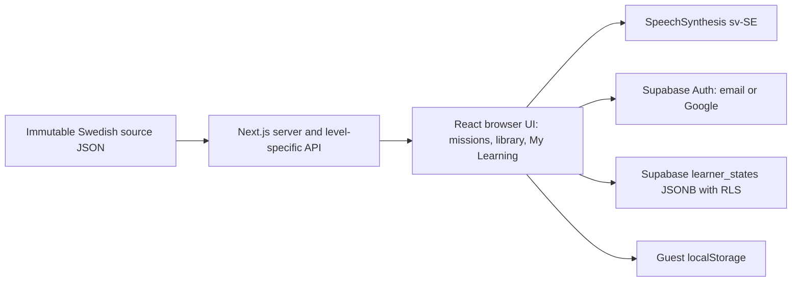
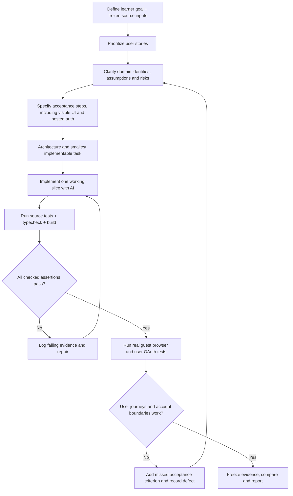

# An Experience Report on a Specification-Driven, AI-Assisted Software Construction Project

**Evidence-based report revision — 14 October 2026**  
**Project:** Nordljud — mission-based Swedish-learning application  
**Course:** Software Construction, Åbo Akademi University  
**Student:** Ali Khalessi  
**Student contributors:** 1 (individual project)  
**Study design:** Three AI-assisted construction approaches sharing frozen educational input; independent application code in separate Git branches.  

## Executive Summary (200–300 words)

Using ChatGPT as my AI development assistant (historical model variant not recorded), I developed Nordljud, a Swedish-learning web application, in three separate ways to explore how AI-assisted programming changes when the working method changes. Condition A used iterative Vibe Coding: I examined intermediate screens, found problems, and requested corrections. Condition B used a broad autonomous “God Mode” instruction that let the agent choose its own engineering practices. Condition C used explicit Specification-Driven Development (SDD), with the official GitHub Spec Kit scaffold, formal requirements, clarification, architecture and tasks before implementation.

Each implementation began from the same frozen Git baseline and reused the same recovered Swedish-language dataset, while application code remained separate. A subsequent request expanded the scope during the first condition, so the comparison is descriptive rather than a controlled experiment.

Independent CI found that all three applications passed TypeScript and production compilation. Vibe’s frozen data tests failed four assertions because they incorrectly assumed 456 uniquely spelled verbs, although the input contains 456 sense records and 455 distinct spellings. God Mode initially made the same assumption, then corrected its tests and user interface. SDD captured that distinction during clarification. A separate Chromium comparison demonstrated another concrete difference: Vibe could not select the second meaning of `sticka`, whereas God Mode and SDD could.

However, SDD itself was not perfect on its first deployment. Login was difficult to find, and a real Google sign-in initially redirected to localhost. Both issues were documented and subsequently corrected; I tested and reported working authentication, retained data and a successful two-account check.

The evidence favors explicit requirements and real acceptance tests for traceability, not an unconditional claim that one AI method always wins. The strongest practical lesson is to combine fast feedback, clear specifications and independently verified behavior.

---

## 1. Introduction and Paradigm Shift (3 marks)

### 1.1 Why I chose this experiment

The interesting part of AI-assisted software construction is not simply whether an AI agent can produce code. It is what happens to requirements, hidden assumptions and verification when we change how the agent is instructed. A chatbot can generate a plausible application very quickly; plausibility and correctness are different things. I wanted one realistic application and three visibly different methods rather than three unrelated demos.

Nordljud is a browser-based Swedish-learning prototype. It has levels A2, B1, B2 and C1, four practical mission seeds, Swedish source examples with English help, two questions per mission, browser speech, a searchable verb collection, Google/email authentication, and saved progress and favorites. The intended outcome is a **university course experience report**, not an independently validated language-teaching curriculum or commercial production release.

### 1.2 Questions, conditions and common starting point

My exploratory question was: **What planning, requirements and verification practices arise under autonomous AI coding, and what additional traceability does an explicit specification-first process supply?**

- **A — Vibe Coding:** build and adjust through conversational prompts and direct UI feedback.
- **B — God Mode:** give the agent broad autonomy and observe which planning, testing and quality practices it initiates voluntarily.
- **C — Specification-Driven Development:** complete a constitution, prioritized specification, clarification decisions, technical plan, tasks and consistency check *before* application implementation.

All three application branches began at the common frozen commit `1afd635324a788f18db19f83f338ad89ade54e33`. The Swedish educational JSON and mission seeds were shared; app implementations were not copied between conditions. The order was A → B → C, which matters because I and the AI agent learned from problems discovered earlier.

### 1.3 Scope and academic integrity

During A, I extended the initial brief to a complete verb explorer, favorites and Google sign-in. This later requirement expansion was recorded in `main:research-evidence/SCOPE_CHANGE_01.md`. It would be misleading to pretend all three were supplied with precisely identical fully specified scope at the outset.

The dataset itself was recovered from previous user-owned learning materials; its language quality was **not independently checked by a Swedish teacher**. This work used AI to generate application code, plans, tests, repository operations and an initial report draft. These roles and limitations must be disclosed in the final submission. I do not invent personal work hours, stakeholder interview answers or screenshots that do not exist.

## 2. Requirements and System Specification (6 marks)

### 2.1 Stakeholders and their rationale

| Stakeholder | Relevance to Nordljud | Evidence or boundary |
|---|---|---|
| **Me — Ali Khalessi (sole student and product owner)** | I chose the Swedish-learning goal, supplied/recovered teaching data, adjusted priorities, configured accounts and inspected live applications. | Direct requests, Git history and my manual feedback; no fictional team meetings. |
| **Adult Swedish learner (primary end user)** | Needs readable Swedish examples, helpful English and speech, reliable question feedback, discoverable sign-in and persistent progress. | Represented by practical mission stories and my manual learning tests; not a separately recruited user study. |
| **Course instructor / assessor** | Needs reproducible evidence of process, prompts, requirements, version control, defects and validation. | Course rubric summary and independent GitHub evidence. Actual instructor access to the private repository remains to be arranged. |
| **Learning-content steward** | Requires recovery provenance, immutable shared datasets and clear disclosure that sentence quality is not teacher-certified. | `shared-content/SOURCE_MANIFEST.md` and frozen educational inputs. |
| **Identity/data provider (Supabase and Google)** | External dependencies constrain OAuth redirects and user-specific data. Not members of the development team. | Supabase browser integration, RLS policy inspection and the real localhost return problem. |

These are stakeholder **roles relevant to requirements**, not five interviewed or actively participating people. I did not carry out a formal stakeholder interview study.

### 2.2 Functional requirements — original specification and dated amendment

The following requirements reproduce the numbering and wording of the **actual SDD source specification**, rather than inventing a new list after implementation. `FR-001`–`FR-020` were recorded before application source. **FR-021 was added after the first SDD release**, in response to my observation that login was hidden under My Learning; it must not be counted as pre-code foresight.

| ID | Requirement from `condition/spec-driven:specs/001-nordljud-classroom/spec.md` |
|---|---|
| FR-001 | Show A2, B1, B2 and C1 learner levels. |
| FR-002 | Offer exactly one representative mission per level, using unchanged shared mission seeds. |
| FR-003 | Display source Swedish example sentences and corresponding English meaning or translation. |
| FR-004 | Let the learner show/hide English assistance. |
| FR-005 | Request a Swedish voice (`sv-SE`) when audio is played, and show a useful status if unavailable. |
| FR-006 | Provide an English meaning comprehension question with correctness feedback. |
| FR-007 | Provide a Swedish verb-form question with correctness feedback; no credit for incorrect answers. |
| FR-008 | Offer searchable browsing across **456 sense records / 455 written lemmas** at each CEFR level, including both `sticka` senses. |
| FR-009 | Preserve the same selected sense across changes in example difficulty. |
| FR-010 | Show all five source word forms; unavailable examples must be explicitly unavailable. |
| FR-011 | Let the learner mark/unmark favorite sense records and review them in My Learning. |
| FR-012 | Offer email/password account creation, sign-in and sign-out. |
| FR-013 | Offer Google OAuth sign-in, with a graceful error if the externally configured provider is unavailable. |
| FR-014 | Save signed-in learner progress and favorites, and restore them after reload/re-login. |
| FR-015 | Enforce access isolation so one learner cannot access another learner's saved activity. |
| FR-016 | Allow guest study on one browser and disclose that guest work is not automatically merged into an account. |
| FR-017 | Display actionable errors for save failures, missing resources, invalid login and missing audio. |
| FR-018 | Work at desktop and narrow mobile widths with keyboard-accessible interactive controls. |
| FR-019 | Never expose elevated Supabase credentials in user-visible assets or source control. |
| FR-020 | Do not modify pre-existing Nordlyd deployments, study data, or experiments A/B. |
| FR-021 | On the initial study view, a signed-out learner MUST see a prominent, keyboard-accessible, plainly labeled **Sign in** control without first opening `My learning`. Selecting it MUST present both the Google login option and email/password sign-in controls **with one interaction**. Signed-in users should instead see recognizable account access. |

**Priorities and traceability:** User Stories 1–2 (missions and verb explorer) are P1; Stories 3–4 (accounts and personal storage) are P2 in the original spec. Given/When/Then criteria and edge cases are in the preserved source specification. The defect-triggered **FR-021** adds the P1 discoverability check and links to Playwright RED/GREEN evidence. The common evaluation cases `F01–F14` were written before implementations; the expanded `G01–G05` checks were recorded separately to avoid rewriting the baseline after A began.

### 2.3 Non-functional requirements and measurable acceptance

The earlier spec has quality constraints but no comprehensive numerical NFR catalogue. The tests/criteria below **operationalize the recorded constraints for the report**. Where a threshold was not originally preregistered, it is explicitly a **retrospective proposed check**, not a claim it was met.

| NFR | Quality attribute / measurable rule | Method of measurement | Evidence status |
|---|---|---|---|
| NFR-01 | **Source integrity:** exactly 456 source sense records per CEFR level; 455 distinct spellings; two `sticka` senses remain. | Deterministic Node source tests + browser selection of both senses. | A uniqueness test FAIL and A sense selection FAIL; B/C corrected/passed selected checks. |
| NFR-02 | **Correctness/buildability:** strict TypeScript, source tests and successful Next.js production build must be reported separately. | Shared CI job on each frozen branch (same Node 22 runner). | All builds/type checks PASS; original A source tests 7/11, B 3/3, C 4/4. |
| NFR-03 | **Per-account privacy:** authenticated SELECT, INSERT, UPDATE and DELETE of `learner_states` require `auth.uid()=user_id`; two accounts do not see each other's UI state. | Read-only PostgreSQL RLS inspection; two-account manual scenario. | RLS configuration confirmed; two-account SDD acceptance reported by me; no adversarial API test. |
| NFR-04 | **Auth findability:** visible accessible `Sign in` on first screen at desktop and **390 px** mobile viewport, with both login methods reachable in one click. | Chromium Playwright assertions. | SDD initial FAIL 2/2 → revised PASS 3/3; requirement added post-release. |
| NFR-05 | **Swedish audio:** request `sv-SE`; when device/browser lacks a Swedish voice, show an actionable notification instead of silent success. | Browser voice/API simulation and physical Swedish voice check. | Implementation reviewed; limited Vibe user feedback; all-device audio NOT TESTED. |
| NFR-06 | **Guest persistence:** two A2 question-completion flags still appear after refresh in the same guest browser. | Independent Playwright guest browser check. | A/B/C PASS on this narrowly defined test. |
| NFR-07 | **Security of client builds:** no elevated Supabase service-role credential in web-delivered source; browser uses public publishable key only. | Review environment variable names, source and built client. | Browser code inspected; comprehensive history-wide secret scan not performed here. |
| NFR-08 | **Responsive usability (proposed full check):** no horizontal overflow at 390 px width, interactive controls reachable by keyboard, readable mission content. | Screen-size and keyboard E2E checklist. | Login entry test PASS in C; full cross-method mobile audit NOT TESTED. |
| NFR-09 | **Performance (proposed target):** first interactive screen ≤ 3 seconds on a defined reference device/network; lexicon request retrieves only one level (456 records), not all four. | Browser performance trace and network payload audit on fixed device/network; selected-level response contract. | Architecture and route verified in C; **three-second target NOT MEASURED**, not a reported result. |
| NFR-10 | **Reproducibility:** identical frozen data input and independently buildable branch per method with commit SHA and test logs. | Git branch and CI artifact checks. | Demonstrated for A/B/C; human/model total time not instrumented. |

### 2.4 Development tools, versions, selection rationale and AI attribution

| Technology or tool | Version/role evidenced by repo | Why it was selected / what it does |
|---|---|---|
| **Next.js / React** | `next: ^15.5.0`, `react: ^19.1.0` in each method's `package.json` (semver ranges, **not proof of exact resolved install versions**). | Interactive web application with App Router and level-specific data endpoints; deployable on Vercel. |
| **TypeScript** | `typescript: ^5.9.0`; strict compiler checking. | Explicit domain models and build-time type feedback. |
| **Supabase JS + Postgres Auth/RLS** | `@supabase/supabase-js: ^2.57.0`; existing `learner_states` JSONB table. | Google and email identity, private account state, existing backend and no bespoke login server. |
| **Browser SpeechSynthesis** | Web API, `sv-SE` locale. | Swedish pronunciation without paid speech infrastructure, subject to device voices. |
| **GitHub and GitHub Actions** | Branch-level provenance; Node.js **22** in independent audit runner. | Same-source automated source tests, typecheck, production compilation and Chromium guest acceptance. |
| **Vercel** | Independent projects for each method. | Preview/production web deployment; caused actual Git-branch target, quota and provider-host issues. |
| **GitHub Spec Kit CLI** | **v1.1.3**, executed and committed in C. | A visible template/process for constitution → spec → clarify → plan → tasks → analyze → implement. |
| **ChatGPT (OpenAI)** | AI development assistant via connected GitHub, Vercel and Supabase tools. **Exact historical model variant for each run was not contemporaneously logged.** | Generated substantial code, draft prompts/agent instructions, tests, workflow artifacts and documentation under my product direction. |

**AI/Copilot distinction:** The Spec Kit CLI was initialized with `--integration copilot`, which creates compatible *templates/skills*. **This does not mean GitHub Copilot itself performed the coding**, nor that all `/speckit-*` commands were executed by a Copilot agent. Documentation was generated through ChatGPT-assisted stages. Historical exact ChatGPT model variants should be filled from contemporaneous model-picker records, not inferred from a current model name.

**Development environment evidence:** GitHub-hosted **Ubuntu** runners using **Node 22** and Playwright/Chromium executed reproducible checks. My initial Vibe browser/audio observations used desktop **Chrome on Windows**, as the log records. The exact local IDE/editor version was **not recorded** in reliable project evidence; I therefore do not claim I used a specific IDE for every condition. Vercel/Supabase configuration was administered through connected services and their dashboards.

### 2.5 System architecture and data flow



The same frozen four-level content is used by all conditions; code is independent. The level-specific API avoids shipping every record in the initial browser bundle. In A, the first explorer module accidentally imported helper types from a module that also imported all source JSON files; the engineer separated lightweight `lib/verb-types.ts` from server-side `lib/verb-library.ts`. This is an observed architectural correction, **not** a measured JavaScript-size benchmark.

For signed-in accounts, each condition uses a distinct JSONB namespace in the existing `learner_states` table (e.g. C: `nordljud_sdd_v1`), rather than replacing other experiments' saved state. For guests, browser local storage retains progress locally; it is not silently merged into a newly authenticated account. Diagram source is preserved in the C `plan.md`; a PDF/Word submission needs a rendered image.

### 2.6 API and interface specification

The source contract is [`condition/spec-driven:specs/001-nordljud-classroom/contracts/lexicon-api.md`](https://github.com/alikhalessi/nordljud-software-construction/blob/condition/spec-driven/specs/001-nordljud-classroom/contracts/lexicon-api.md). It defines a **public, read-only teaching content** API:

| Field | Contract |
|---|---|
| HTTP method | `GET` |
| Route | `/api/lexicon/{level}`; `{level}` ∈ A2, B1, B2, C1 |
| Authentication | **None required** for public educational content; no personal state returned. |
| Valid response | HTTP **200** with `level`, `count: 456`, and `items` array of 456 complete source `VerbSense` records. |
| Invalid CEFR level | HTTP **404**, JSON `{"error":"Unsupported learning level"}`; no silent A2 fallback. |
| Entry fields | Written verb `v`, English `meaning`, source metadata and up to five forms (`Inf`, `Imp`, `Pres`, `Pret`, `Sup`), including `word`, Swedish `sv` and English `en` when present. |
| Identity invariant | Two `sticka` senses remain separate; select by lemma **and** meaning rather than spelling alone. |
| Privacy | No user email, access token or `service_role` returned by teaching endpoint. |
| Account state | Separate Supabase Auth SDK and per-user `learner_states` SELECT/UPSERT guarded by RLS; **not** a custom public learner-profile API. |
| External configuration | Google OAuth redirects must be allowed in Supabase URL configuration; an HTTP 200 lexicon response or green Build **does not establish successful OAuth**. |

**Schema illustration (not a captured complete live payload):**

```json
{
  "level": "A2",
  "count": 456,
  "items": [
    {
      "v": "arbeta",
      "meaning": "work",
      "forms": {
        "Pres": {
          "word": "arbetar",
          "sv": "<source Swedish example>",
          "en": "<source English translation>"
        }
      }
    }
  ]
}
```

The ellipsis-style example content is explanatory notation, **not** a source-data fixture or a fabricated translation. The actual API returns source records with the available form fields; content should be compared against frozen JSON.


## 3. Vibe Coding Experience (5 marks)

### 3.1 Building through feedback

Condition A developed through iterative requests and inspection of a deployed interface. It gained four missions, a verb explorer, browser-based Swedish audio, Google/email account flow, favorites and a personal learning area.

The genuine Vibe log documents several user-discovered corrections: a deployment tried to build the coordinating `main` branch before application code was available; audio needed a better voice-loading fallback; switching CEFR difficulty initially reset the selected verb; and Google sign-in required external Google/Supabase provider configuration. These were implementation and deployment feedback loops, not invented examples added after the fact.

The public classroom pilot was placed at **https://nordljud.vercel.app**. I reported that the website and configured Google login worked, but this is not an assertion that I completed all F01–F14 tests.

### 3.2 What the independent verification showed

On 14 October, a coordinating GitHub Actions workflow checked out the unchanged Vibe branch at `c4e610e87943e8ac2ae7b23b00bcdf960ee68b30` and ran source tests, TypeScript and Next.js production compilation separately.

- **Data tests: 7/11 passed; four failed.** All four failures expected 456 unique written lemmas instead of the actual 455.
- **TypeScript: PASS.**
- **Next.js build: PASS.**

A subsequent independent Chromium run navigated through A2, B1, B2 and C1 and verified the selected target verbs and visible Swedish examples. That guest navigation test **passed**. The second test selected both `sticka` entries and checked the detail pane. This **failed reproducibly**: after selecting the second meaning, the detail text still showed **“knit”**, where **“sting”** was expected.

Source inspection explains the failure: `selectedVerb`, the React result key and favorites use only `entry.v`, which conflates the two meanings. This is a real user-facing identity defect, **separate from** the incorrect uniqueness test.

I preserved the original Vibe branch, rather than silently repairing it and changing the evidence of the initial method. If Nordljud later becomes a product, this bug should be fixed in a distinct post-experiment release.

## 4. Specification-Driven Development Experience (7 marks)

### 4.1 Official toolkit versus actual workflow

The project genuinely initialized **GitHub Spec Kit 1.1.3** through GitHub Actions [run 38319369671](https://github.com/alikhalessi/nordljud-software-construction/actions/runs/38319369671), committing the official `.specify` templates, scripts and Copilot integration files.

I must qualify an important methodological detail: the assistant prepared the constitution, specification, clarification, plan, task list and consistency review **using the initialized toolkit's structures and SDD workflow**. The evidence does **not** show a separate Copilot agent literally invoking every `/speckit-*` slash command. It would be inaccurate to claim a fully autonomous end-to-end official slash-command sequence.

### 4.2 Concrete pre-code artifacts

The independent `condition/spec-driven` branch committed the following before creating the application source:

- Constitution defining no cross-condition code reuse, source-data fidelity, authenticated isolation, traceable requirements and minimum classroom scope.
- Specification with four prioritized user stories, originally 20 numbered requirements and independently testable acceptance cases.
- Ten clarification decisions, including `sticka`'s two senses, guest storage and Google OAuth environment dependencies.
- Architecture plan, teaching/data model, level-specific HTTP API contract, research decisions and quickstart.
- Twenty ordered path-specific tasks plus a documented consistency check.

This sequence was verifiable through Git commits. The explicit ambiguity resolution is a genuine benefit: C did not reproduce the original false `456 unique lemmas` assertion in its data tests.

### 4.3 Important first-release failures — not a perfect initial delivery

**Failure 1: Login discoverability.** The original SDD code contained Google/email sign-in handlers and a form, but the account panel was hidden under **My Learning**, with no clear Sign in action on the landing screen. The original requirements specified *having* login but not *finding* it. After I noticed and reported the issue, `FR-021` was added as a dated change. Real Chromium tests failed **2/2 before the fix** ([RED run 38376988433](https://github.com/alikhalessi/nordljud-software-construction/actions/runs/38376988433)) and passed **3/3 afterward** ([GREEN run 38377362037](https://github.com/alikhalessi/nordljud-software-construction/actions/runs/38377362037)), including desktop, narrow-mobile and preserved My Learning access.

**Failure 2: Google OAuth returned to localhost.** Clicking Google showed the account chooser, but selecting an account initially redirected to `localhost:3000` instead of the Vercel app. The source already supplied a hosted-origin `redirectTo`. Supabase's documentation identifies a missing allowed Redirect URL as a leading explanation for fallback to the configured Site URL. I later confirmed that real Google sign-in worked after receiving redirect-allowlist guidance. The Supabase dashboard's exact URL configuration was not independently captured, so this is the most likely cause, not a forensic proof of the setting that changed.

I subsequently confirmed that saved information survived sign-out and re-login. After being asked to try a two-account isolation scenario, I reported that the test worked very well. These are **my reported manual acceptance results**, not independently recorded adversarial RLS tests or account-data screenshots.

### 4.4 Outcome and lesson from the method

The latest independent CI successfully ran SDD's **4/4 source tests**, strict TypeScript and optimized production build. An independent guest-browser suite passed both the four-level mission test and `sticka`-sense selection test. These are real strengths within the measured scope.

Nevertheless, initial SDD specifications and green CI did **not** guarantee a flawless first deployment. The live login defects demonstrate why the SDD process needs an actual **convergence/acceptance stage**, not just an impressive specification directory.

## 5. Verification and Validation (6 marks)

### 5.1 Actual repeatable A/B/C audit

The coordinating workflow [38483644760](https://github.com/alikhalessi/nordljud-software-construction/actions/runs/38483644760) checked out the three original method branches independently. Its source-test stage continued even after a failure so later type/build outcomes could be observed. This does **not** turn failed Vibe tests into a PASS.

| Verification evidence | A — Vibe | B — God Mode | C — SDD |
|---|---|---|---|
| Source-data tests | **7/11 PASS; 4 FAIL** | **3/3 PASS** | **4/4 PASS** |
| TypeScript | PASS | PASS | PASS |
| Production compilation | PASS | PASS | PASS |
| Guest Chromium A2/B1/B2/C1 mission navigation | PASS | PASS | PASS |
| Guest Chromium selecting both `sticka` senses | **FAIL** | PASS | PASS |
| Clear Sign in entry on initial screen | Code present; not independently rechecked | Code present; not independently rechecked | Initially FAIL; after correction **3/3 browser checks PASS** |
| Google OAuth sign-in on each deployment | PASS (my manual report) | NOT VERIFIED | PASS (my manual report after repair) |
| Same-user saved data after sign-out/re-login | NOT VERIFIED in a specific test | NOT VERIFIED | PASS (my manual report, aggregate data) |
| Two-user account separation | NOT VERIFIED | NOT VERIFIED | PASS (my reported two-account check); database RLS independently reviewed |

Guest-browser evidence: [run 38484033148](https://github.com/alikhalessi/nordljud-software-construction/actions/runs/38484033148) and [repeat run 38484229887](https://github.com/alikhalessi/nordljud-software-construction/actions/runs/38484229887). The repeated run reproduced Vibe's **1/2** result and God Mode/SDD's **2/2** results.

The tests use different method-specific selectors but the same two behaviors: choose four mission levels with target Swedish verbs, and select two distinct meanings of `sticka`. They run the apps locally as guests. **They do not test remote Google grants, actual speech voices, password confirmation, multi-device data synchronization or an API-level security attack.**

### 5.2 What remains incomplete

The separate [F01–F14 acceptance matrix](../evaluation/COMPARATIVE_ACCEPTANCE_MATRIX_2026-10-14.md) distinguishes **PASS**, **PARTIAL**, **FAIL** and **NOT TESTED**. In particular, email/password registration and invalid credentials, actual speech playback in all three browsers, both exercise feedback routes, exact partial/full mission-state retention, comprehensive mobile workflows and screenshot evidence have not been independently established for each condition. My general report that a page works is useful evidence, but it should not silently mark all those cases PASS.

No fake screenshots, Google credentials, authorization codes or user IDs were created or placed in source control. Supabase RLS policy inspection was read-only and returned only policy definitions, not users' learning records.

### 5.3 Why the failures matter

Three differences are especially revealing:

1. **Incorrect specification of uniqueness:** both A and the original B test assumed 456 unique spellings, while C explicitly separated records from lemmas.
2. **Actual UI consequence:** Vibe's spelling-only selection also conflated the two `sticka` meanings; B fixed this after CI feedback; C modeled sense identity before source implementation.
3. **Integration acceptance gap:** C still failed human login discovery and real OAuth on its initial release, showing that written traceability and build green status do not substitute for meaningful stakeholder acceptance.

## 6. Project Management, AI Toolchains and Git (3 marks)

The source repository is [alikhalessi/nordljud-software-construction](https://github.com/alikhalessi/nordljud-software-construction). Its default `main` branch stores coordination, frozen common content, independent evaluator workflows and the report. Three self-contained implementation roots live on `condition/vibe`, `condition/god-mode` and `condition/spec-driven`. The numbered `01-vibe-coding` / `02-god-mode` / `03-spec-driven` directories on main link to these branches rather than containing merged competing app roots.

### 6.1 Individual project and contribution record

I, **Ali Khalessi**, am the **only student** working on this Nordljud project. There are **no other student team members**. My GitHub username for this repository is `alikhalessi`. The three development *conditions* (Vibe Coding, God Mode and SDD) are three software implementations—not three people or student teams.

| Participant | Role | Documented contribution |
|---|---|---|
| **Ali Khalessi (one student)** | Project owner, requirements owner, human reviewer and tester | Chose the Swedish-learning use case and common materials; requested changes and decided scope; evaluated screens and live behavior; configured Google/Supabase integrations; reported and manually retested defects, login, data retention and two-account behavior; coordinated the university experiment |
| **ChatGPT (AI development assistant; not a student)** | AI-assisted implementation and documentation | Generated substantial application code, tests, CI workflows, architectural/specification artifacts, technical logs and report drafts under my direction; assisted with GitHub/Vercel/Supabase operations |
| **GitHub Actions automation (not a student)** | Automated checks and commits | Ran CI/Chromium checks and generated automated project artifacts; any bot-authored commits are automation activity rather than another team member's coursework |

**Individual-submission approval is not evidenced here.** If the course formally requires three students, I need the instructor's written acceptance of an individual submission (or an approved alternative). I do not present ChatGPT or a GitHub bot as a student teammate. This section describes confirmed project participation, not an invented team-work history.

### 6.2 Human–AI division of work

I supplied the learning goal and source materials, set priorities, reviewed visible outcomes, handled external account configuration where needed, and reported/retested defects. ChatGPT generated much of the implementation, prompts, source tests, CI definitions, technical documents and this report draft. Some Git commits are attributed to my connected GitHub account even when the file content was prepared using AI tools; **Git commit authorship alone is not proof that code was manually typed by me**. Exact prompts and AI assistance must still be disclosed in the final submission under the course policy.

Important recorded engineering disruptions include a wrong-target Vercel build, daily Vercel API deployment quota, accidental extra deployments from multiple projects connected to one repository, Google redirect allowlisting, failed unique-lemma assertions, and missing login discoverability. They were **not** erased from Git history.

A previous snapshot compared Git commit counts (36 Vibe, 21 God Mode, 31 SDD); the count changes when additional research/repair commits occur. Git counts are useful for provenance, but not direct measures of hours, code quality or student learning. The experiment did not instrument comparable wall-clock duration, and I do not supply fabricated timings.

## 7. Reflections and a Reusable Process (5 marks)

### 7.1 What each condition taught me

**Vibe Coding** produced a usable application and useful human feedback quickly, but the process depended on noticing problems after the user could interact with the product. It passed an independent build and mission-navigation check, yet the preserved version still mishandles two senses of a homograph.

**God Mode** demonstrated that an autonomous agent can spontaneously create meaningful structure: domain modules, notes, tests and CI. It also showed that autonomous structure is not necessarily correct structure: the first test suite embodied the same wrong “456 unique verbs” assumption. After correction, a shared browser test confirmed independent `sticka` senses.

**SDD** made assumptions, responsibilities and verification criteria easier to trace. It identified sense identity earlier and passed the narrow independent browser comparison. But it still missed a discoverable Login entry point and a necessary real OAuth deployment configuration. A *complete-looking specification* is not necessarily complete from a human user's perspective.

### 7.2 An evidence-aware conclusion

These observations **do not prove a universal ranking** such as “SDD always builds better software” or “God Mode replaces specification.” They support a narrower conclusion: formal requirements and clarifications can prevent some domain errors; test-driven feedback can repair them later; and end-to-end validation is essential regardless of method.

Threats to validity are significant: one application, one student, one AI assistant, fixed order A→B→C, expanding requirements during A, learning/knowledge transfer between conditions, unequal original test suites, different deployment opportunities and incomplete external authentication testing. The code bases are independent, but the people and agent participating in them are not experientially blind.

### 7.3 Proposed practical hybrid approach



For a small and reversible feature, a lightweight story and two or three explicit acceptance conditions may be enough. For identity, privacy, ambiguous linguistic source records and external Google login, more formal clarification and integration tests are worth the additional effort. The goal is not paperwork for its own sake; it is to make important assumptions testable **before** a student or user discovers them the hard way.

One lesson is worth keeping: *A green Build button cannot tell us whether a Swedish verb has two meanings, or whether Google will send our user to localhost.*

---

## References and Reproducible Primary Evidence

The authoritative evidence is the Git history, experiment files, CI logs and explicit student feedback. The final submission should cite the course's approved AI-use guidelines and link or attach these materials as allowed.

- [Default GitHub repository and navigation](https://github.com/alikhalessi/nordljud-software-construction)
- [Vibe app and source log](https://github.com/alikhalessi/nordljud-software-construction/tree/condition/vibe)
- [God Mode app, autonomous notes and CI fix log](https://github.com/alikhalessi/nordljud-software-construction/tree/condition/god-mode)
- [SDD app, Spec Kit scaffold and feature documents](https://github.com/alikhalessi/nordljud-software-construction/tree/condition/spec-driven)
- [Independent data/type/build audit — 3 methods](https://github.com/alikhalessi/nordljud-software-construction/actions/runs/38483644760)
- [Independent guest Chromium audit — original](https://github.com/alikhalessi/nordljud-software-construction/actions/runs/38484033148)
- [Independent guest Chromium audit — reproducibility rerun](https://github.com/alikhalessi/nordljud-software-construction/actions/runs/38484229887)
- [Vibe homograph failure and exact Chromium assertion](../evaluation/DEFECT_VIBE_HOMOGRAPH_2026-10-14.md)
- [SDD user acceptance and two-account report](../evaluation/SDD_USER_ACCEPTANCE_2026-10-13.md)
- [F01–F14 detailed cross-condition test matrix](../evaluation/COMPARATIVE_ACCEPTANCE_MATRIX_2026-10-14.md)
- [Actual Spec Kit CLI initialization](https://github.com/alikhalessi/nordljud-software-construction/actions/runs/38319369671)
- [SDD pre-fix failing login browser test](https://github.com/alikhalessi/nordljud-software-construction/actions/runs/38376988433)
- [SDD post-fix passing login browser test](https://github.com/alikhalessi/nordljud-software-construction/actions/runs/38377362037)
- [GitHub Spec Kit official repository](https://github.com/github/spec-kit)
- [Supabase Auth allowed redirect URLs](https://supabase.com/docs/guides/auth/redirect-urls)

## Submission review checklist (not evidence of a completed test)

- [x] Project participant identity confirmed: Ali Khalessi is the sole student; no student collaborators. Individual-submission approval (if required by the course) is **not yet verified**.
- [ ] Final official Moodle rubric, deadline and AI-use disclosure requirements are checked against the live course page; the project currently has only the student-supplied rubric mapping.
- [ ] Insert genuine screenshots of the three UIs and at least one failing-to-passing test sequence, with all account details blurred.
- [ ] Keep F01–F14 entries NOT TESTED where no actual run was performed. Decide with the instructor whether remaining user-authenticated tests are mandatory.
- [ ] Add reliable timing metrics only if records actually support them; otherwise state time was not measured.
- [ ] Keep no raw OAuth tokens, email addresses or other private user data in the submission.


---

## Addendum — Third independent guest-browser test (14 October 2026)

After the revised report draft was prepared, an additional **identical** guest-only Chromium acceptance check was run on all three unchanged app roots. It tested whether users could complete both A2 question groups and whether the resulting guest completion flags remained after refreshing the same browser. The tests **did not** access Supabase accounts or check the correctness of wrong-answer messaging.

- Vibe: A2 mission navigation PASS, two-`sticka` selection **FAIL**, A2 exercise completion + reload **PASS** — **2/3** common browser tests.
- God Mode: all three checks **PASS — 3/3**.
- SDD: all three checks **PASS — 3/3**.

Evidence: [independent third-check Chromium run 38485026386](https://github.com/alikhalessi/nordljud-software-construction/actions/runs/38485026386). Each method's job contains its individual actual test outcome; GitHub's overall green workflow indicator results from continuing after the Vibe assertion failure to preserve other checks. Therefore it **does not mean all three methods passed**.

The same run produced guest-mode screenshots of the initial A2 mission, the result of selecting the second `sticka` sense, and A2 questions after completion. These can be downloaded from CI artifacts (see [Screenshot Evidence Index](../evaluation/SCREENSHOT_EVIDENCE_INDEX_2026-10-14.md)) and are intended for authentic visuals in the final course submission. The artifacts are time-limited and are **not yet embedded as figure images** in this Markdown report.

This extension strengthens the finding that all three programs can complete and recover guest exercises, whereas the frozen Vibe branch still conflates two homograph meanings. It does **not** verify Google's OAuth flow in B, invalid email passwords, F10 under adversarial requests, actual audio hardware, or overall pedagogical correctness.
