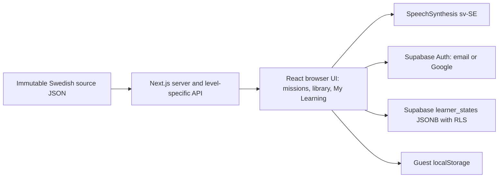
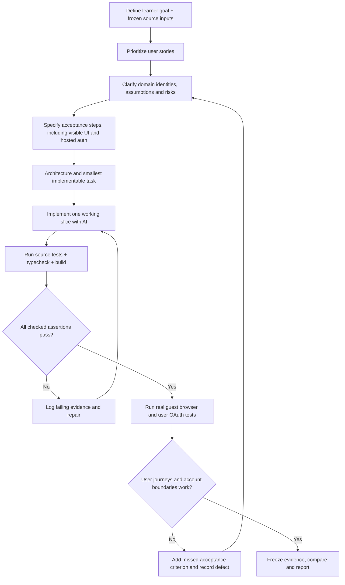

# An Experience Report on a Specification-Driven, AI-Assisted Software Construction Project

**Evidence-based report revision — 14 October 2026**  
**Project:** Nordljud — mission-based Swedish-learning application  
**Course:** Software Construction, Åbo Akademi University  
**Student:** Ali Khalessi  
**Student contributors:** 1 (individual project)  
**Study design:** Three AI-assisted construction approaches sharing frozen educational input; independent application code in separate Git branches.  

## Executive Summary (200–300 words)

Using ChatGPT as my AI development assistant (historical model variant not recorded), I developed Nordljud, a Swedish-learning web application, in three separate ways to explore how AI-assisted programming changes when the working method changes. Condition A used iterative Vibe Coding: I examined intermediate screens, found problems, and requested corrections. Condition B used a broad autonomous “God Mode” instruction that let the agent choose its own engineering practices. Condition C used explicit Specification-Driven Development (SDD), with the official GitHub Spec Kit scaffold, formal requirements, clarification, architecture and tasks before implementation.

Each implementation began from the same frozen Git baseline and reused the same recovered Swedish-language dataset, while application code remained separate. A subsequent request expanded the scope during the first condition, so the comparison is descriptive rather than a controlled experiment.

Independent CI found that all three applications passed TypeScript and production compilation. Vibe’s frozen data tests failed four assertions because they incorrectly assumed 456 uniquely spelled verbs, although the input contains 456 sense records and 455 distinct spellings. God Mode initially made the same assumption, then corrected its tests and user interface. SDD captured that distinction during clarification. A separate Chromium comparison demonstrated another concrete difference: Vibe could not select the second meaning of `sticka`, whereas God Mode and SDD could.

However, SDD itself was not perfect on its first deployment. Login was difficult to find, and a real Google sign-in initially redirected to localhost. Both issues were documented and subsequently corrected; I tested and reported working authentication, retained data and a successful two-account check.

The evidence favors explicit requirements and real acceptance tests for traceability, not an unconditional claim that one AI method always wins. The strongest practical lesson is to combine fast feedback, clear specifications and independently verified behavior.

---

## 1. Introduction and Paradigm Shift (3 marks)

### 1.1 Why I chose this experiment

The interesting part of AI-assisted software construction is not simply whether an AI agent can produce code. It is what happens to requirements, hidden assumptions and verification when we change how the agent is instructed. A chatbot can generate a plausible application very quickly; plausibility and correctness are different things. I wanted one realistic application and three visibly different methods rather than three unrelated demos.

Nordljud is a browser-based Swedish-learning prototype. It has levels A2, B1, B2 and C1, four practical mission seeds, Swedish source examples with English help, two questions per mission, browser speech, a searchable verb collection, Google/email authentication, and saved progress and favorites. The intended outcome is a **university course experience report**, not an independently validated language-teaching curriculum or commercial production release.

### 1.2 Questions, conditions and common starting point

My exploratory question was: **What planning, requirements and verification practices arise under autonomous AI coding, and what additional traceability does an explicit specification-first process supply?**

- **A — Vibe Coding:** build and adjust through conversational prompts and direct UI feedback.
- **B — God Mode:** give the agent broad autonomy and observe which planning, testing and quality practices it initiates voluntarily.
- **C — Specification-Driven Development:** complete a constitution, prioritized specification, clarification decisions, technical plan, tasks and consistency check *before* application implementation.

All three application branches began at the common frozen commit `1afd635324a788f18db19f83f338ad89ade54e33`. The Swedish educational JSON and mission seeds were shared; app implementations were not copied between conditions. The order was A → B → C, which matters because I and the AI agent learned from problems discovered earlier.

### 1.3 Scope and academic integrity

During A, I extended the initial brief to a complete verb explorer, favorites and Google sign-in. This later requirement expansion was recorded in `main:research-evidence/SCOPE_CHANGE_01.md`. It would be misleading to pretend all three were supplied with precisely identical fully specified scope at the outset.

The dataset itself was recovered from previous user-owned learning materials; its language quality was **not independently checked by a Swedish teacher**. This work used AI to generate application code, plans, tests, repository operations and an initial report draft. These roles and limitations must be disclosed in the final submission. I do not invent personal work hours, stakeholder interview answers or screenshots that do not exist.

## 2. Requirements and System Specification (6 marks)

### 2.1 Stakeholders and their rationale

| Stakeholder | Relevance to Nordljud | Evidence or boundary |
|---|---|---|
| **Me — Ali Khalessi (sole student and product owner)** | I chose the Swedish-learning goal, supplied/recovered teaching data, adjusted priorities, configured accounts and inspected live applications. | Direct requests, Git history and my manual feedback; no fictional team meetings. |
| **Adult Swedish learner (primary end user)** | Needs readable Swedish examples, helpful English and speech, reliable question feedback, discoverable sign-in and persistent progress. | Represented by practical mission stories and my manual learning tests; not a separately recruited user study. |
| **Course instructor / assessor** | Needs reproducible evidence of process, prompts, requirements, version control, defects and validation. | Course rubric summary and independent GitHub evidence. Actual instructor access to the private repository remains to be arranged. |
| **Learning-content steward** | Requires recovery provenance, immutable shared datasets and clear disclosure that sentence quality is not teacher-certified. | `shared-content/SOURCE_MANIFEST.md` and frozen educational inputs. |
| **Identity/data provider (Supabase and Google)** | External dependencies constrain OAuth redirects and user-specific data. Not members of the development team. | Supabase browser integration, RLS policy inspection and the real localhost return problem. |

These are stakeholder **roles relevant to requirements**, not five interviewed or actively participating people. I did not carry out a formal stakeholder interview study.

### 2.2 Functional requirements — original specification and dated amendment

The following requirements reproduce the numbering and wording of the **actual SDD source specification**, rather than inventing a new list after implementation. `FR-001`–`FR-020` were recorded before application source. **FR-021 was added after the first SDD release**, in response to my observation that login was hidden under My Learning; it must not be counted as pre-code foresight.

| ID | Requirement from `condition/spec-driven:specs/001-nordljud-classroom/spec.md` |
|---|---|
| FR-001 | Show A2, B1, B2 and C1 learner levels. |
| FR-002 | Offer exactly one representative mission per level, using unchanged shared mission seeds. |
| FR-003 | Display source Swedish example sentences and corresponding English meaning or translation. |
| FR-004 | Let the learner show/hide English assistance. |
| FR-005 | Request a Swedish voice (`sv-SE`) when audio is played, and show a useful status if unavailable. |
| FR-006 | Provide an English meaning comprehension question with correctness feedback. |
| FR-007 | Provide a Swedish verb-form question with correctness feedback; no credit for incorrect answers. |
| FR-008 | Offer searchable browsing across **456 sense records / 455 written lemmas** at each CEFR level, including both `sticka` senses. |
| FR-009 | Preserve the same selected sense across changes in example difficulty. |
| FR-010 | Show all five source word forms; unavailable examples must be explicitly unavailable. |
| FR-011 | Let the learner mark/unmark favorite sense records and review them in My Learning. |
| FR-012 | Offer email/password account creation, sign-in and sign-out. |
| FR-013 | Offer Google OAuth sign-in, with a graceful error if the externally configured provider is unavailable. |
| FR-014 | Save signed-in learner progress and favorites, and restore them after reload/re-login. |
| FR-015 | Enforce access isolation so one learner cannot access another learner's saved activity. |
| FR-016 | Allow guest study on one browser and disclose that guest work is not automatically merged into an account. |
| FR-017 | Display actionable errors for save failures, missing resources, invalid login and missing audio. |
| FR-018 | Work at desktop and narrow mobile widths with keyboard-accessible interactive controls. |
| FR-019 | Never expose elevated Supabase credentials in user-visible assets or source control. |
| FR-020 | Do not modify pre-existing Nordlyd deployments, study data, or experiments A/B. |
| FR-021 | On the initial study view, a signed-out learner MUST see a prominent, keyboard-accessible, plainly labeled **Sign in** control without first opening `My learning`. Selecting it MUST present both the Google login option and email/password sign-in controls **with one interaction**. Signed-in users should instead see recognizable account access. |

**Priorities and traceability:** User Stories 1–2 (missions and verb explorer) are P1; Stories 3–4 (accounts and personal storage) are P2 in the original spec. Given/When/Then criteria and edge cases are in the preserved source specification. The defect-triggered **FR-021** adds the P1 discoverability check and links to Playwright RED/GREEN evidence. The common evaluation cases `F01–F14` were written before implementations; the expanded `G01–G05` checks were recorded separately to avoid rewriting the baseline after A began.

### 2.3 Non-functional requirements and measurable acceptance

The earlier spec has quality constraints but no comprehensive numerical NFR catalogue. The tests/criteria below **operationalize the recorded constraints for the report**. Where a threshold was not originally preregistered, it is explicitly a **retrospective proposed check**, not a claim it was met.

| NFR | Quality attribute / measurable rule | Method of measurement | Evidence status |
|---|---|---|---|
| NFR-01 | **Source integrity:** exactly 456 source sense records per CEFR level; 455 distinct spellings; two `sticka` senses remain. | Deterministic Node source tests + browser selection of both senses. | A uniqueness test FAIL and A sense selection FAIL; B/C corrected/passed selected checks. |
| NFR-02 | **Correctness/buildability:** strict TypeScript, source tests and successful Next.js production build must be reported separately. | Shared CI job on each frozen branch (same Node 22 runner). | All builds/type checks PASS; original A source tests 7/11, B 3/3, C 4/4. |
| NFR-03 | **Per-account privacy:** authenticated SELECT, INSERT, UPDATE and DELETE of `learner_states` require `auth.uid()=user_id`; two accounts do not see each other's UI state. | Read-only PostgreSQL RLS inspection; two-account manual scenario. | RLS configuration confirmed; two-account SDD acceptance reported by me; no adversarial API test. |
| NFR-04 | **Auth findability:** visible accessible `Sign in` on first screen at desktop and **390 px** mobile viewport, with both login methods reachable in one click. | Chromium Playwright assertions. | SDD initial FAIL 2/2 → revised PASS 3/3; requirement added post-release. |
| NFR-05 | **Swedish audio:** request `sv-SE`; when device/browser lacks a Swedish voice, show an actionable notification instead of silent success. | Browser voice/API simulation and physical Swedish voice check. | Implementation reviewed; limited Vibe user feedback; all-device audio NOT TESTED. |
| NFR-06 | **Guest persistence:** two A2 question-completion flags still appear after refresh in the same guest browser. | Independent Playwright guest browser check. | A/B/C PASS on this narrowly defined test. |
| NFR-07 | **Security of client builds:** no elevated Supabase service-role credential in web-delivered source; browser uses public publishable key only. | Review environment variable names, source and built client. | Browser code inspected; comprehensive history-wide secret scan not performed here. |
| NFR-08 | **Responsive usability (proposed full check):** no horizontal overflow at 390 px width, interactive controls reachable by keyboard, readable mission content. | Screen-size and keyboard E2E checklist. | Login entry test PASS in C; full cross-method mobile audit NOT TESTED. |
| NFR-09 | **Performance (proposed target):** first interactive screen ≤ 3 seconds on a defined reference device/network; lexicon request retrieves only one level (456 records), not all four. | Browser performance trace and network payload audit on fixed device/network; selected-level response contract. | Architecture and route verified in C; **three-second target NOT MEASURED**, not a reported result. |
| NFR-10 | **Reproducibility:** identical frozen data input and independently buildable branch per method with commit SHA and test logs. | Git branch and CI artifact checks. | Demonstrated for A/B/C; human/model total time not instrumented. |

### 2.4 Development tools, versions, selection rationale and AI attribution

| Technology or tool | Version/role evidenced by repo | Why it was selected / what it does |
|---|---|---|
| **Next.js / React** | `next: ^15.5.0`, `react: ^19.1.0` in each method's `package.json` (semver ranges, **not proof of exact resolved install versions**). | Interactive web application with App Router and level-specific data endpoints; deployable on Vercel. |
| **TypeScript** | `typescript: ^5.9.0`; strict compiler checking. | Explicit domain models and build-time type feedback. |
| **Supabase JS + Postgres Auth/RLS** | `@supabase/supabase-js: ^2.57.0`; existing `learner_states` JSONB table. | Google and email identity, private account state, existing backend and no bespoke login server. |
| **Browser SpeechSynthesis** | Web API, `sv-SE` locale. | Swedish pronunciation without paid speech infrastructure, subject to device voices. |
| **GitHub and GitHub Actions** | Branch-level provenance; Node.js **22** in independent audit runner. | Same-source automated source tests, typecheck, production compilation and Chromium guest acceptance. |
| **Vercel** | Independent projects for each method. | Preview/production web deployment; caused actual Git-branch target, quota and provider-host issues. |
| **GitHub Spec Kit CLI** | **v1.1.3**, executed and committed in C. | A visible template/process for constitution → spec → clarify → plan → tasks → analyze → implement. |
| **ChatGPT (OpenAI)** | AI development assistant via connected GitHub, Vercel and Supabase tools. **Exact historical model variant for each run was not contemporaneously logged.** | Generated substantial code, draft prompts/agent instructions, tests, workflow artifacts and documentation under my product direction. |

**AI/Copilot distinction:** The Spec Kit CLI was initialized with `--integration copilot`, which creates compatible *templates/skills*. **This does not mean GitHub Copilot itself performed the coding**, nor that all `/speckit-*` commands were executed by a Copilot agent. Documentation was generated through ChatGPT-assisted stages. Historical exact ChatGPT model variants should be filled from contemporaneous model-picker records, not inferred from a current model name.

**Development environment evidence:** GitHub-hosted **Ubuntu** runners using **Node 22** and Playwright/Chromium executed reproducible checks. My initial Vibe browser/audio observations used desktop **Chrome on Windows**, as the log records. The exact local IDE/editor version was **not recorded** in reliable project evidence; I therefore do not claim I used a specific IDE for every condition. Vercel/Supabase configuration was administered through connected services and their dashboards.

### 2.5 System architecture and data flow



The same frozen four-level content is used by all conditions; code is independent. The level-specific API avoids shipping every record in the initial browser bundle. In A, the first explorer module accidentally imported helper types from a module that also imported all source JSON files; the engineer separated lightweight `lib/verb-types.ts` from server-side `lib/verb-library.ts`. This is an observed architectural correction, **not** a measured JavaScript-size benchmark.

For signed-in accounts, each condition uses a distinct JSONB namespace in the existing `learner_states` table (e.g. C: `nordljud_sdd_v1`), rather than replacing other experiments' saved state. For guests, browser local storage retains progress locally; it is not silently merged into a newly authenticated account. Diagram source is preserved in the C `plan.md`; a PDF/Word submission needs a rendered image.

### 2.6 API and interface specification

The source contract is [`condition/spec-driven:specs/001-nordljud-classroom/contracts/lexicon-api.md`](https://github.com/alikhalessi/nordljud-software-construction/blob/condition/spec-driven/specs/001-nordljud-classroom/contracts/lexicon-api.md). It defines a **public, read-only teaching content** API:

| Field | Contract |
|---|---|
| HTTP method | `GET` |
| Route | `/api/lexicon/{level}`; `{level}` ∈ A2, B1, B2, C1 |
| Authentication | **None required** for public educational content; no personal state returned. |
| Valid response | HTTP **200** with `level`, `count: 456`, and `items` array of 456 complete source `VerbSense` records. |
| Invalid CEFR level | HTTP **404**, JSON `{"error":"Unsupported learning level"}`; no silent A2 fallback. |
| Entry fields | Written verb `v`, English `meaning`, source metadata and up to five forms (`Inf`, `Imp`, `Pres`, `Pret`, `Sup`), including `word`, Swedish `sv` and English `en` when present. |
| Identity invariant | Two `sticka` senses remain separate; select by lemma **and** meaning rather than spelling alone. |
| Privacy | No user email, access token or `service_role` returned by teaching endpoint. |
| Account state | Separate Supabase Auth SDK and per-user `learner_states` SELECT/UPSERT guarded by RLS; **not** a custom public learner-profile API. |
| External configuration | Google OAuth redirects must be allowed in Supabase URL configuration; an HTTP 200 lexicon response or green Build **does not establish successful OAuth**. |

**Schema illustration (not a captured complete live payload):**

```json
{
  "level": "A2",
  "count": 456,
  "items": [
    {
      "v": "arbeta",
      "meaning": "work",
      "forms": {
        "Pres": {
          "word": "arbetar",
          "sv": "<source Swedish example>",
          "en": "<source English translation>"
        }
      }
    }
  ]
}
```

The ellipsis-style example content is explanatory notation, **not** a source-data fixture or a fabricated translation. The actual API returns source records with the available form fields; content should be compared against frozen JSON.


## 3. Vibe Coding Experience (5 marks)

### 3.1 Vibe Coding framework and initial development approach

In this experiment I treated **Vibe Coding as an iterative human–AI development loop**: explain a small product goal in natural language, let ChatGPT propose and write a workable increment, observe the actual browser/build result, and redirect the next increment with specific feedback. Its defining feature here was **interactive feedback**, not deliberately weak prompts or skipping tests. The common branch baseline guaranteed the recovered educational source was the same before the methods diverged.

My first development request continued the already-discussed Nordljud project. The application was a Next.js/React/TypeScript Swedish-learning classroom MVP with four CEFR levels, practical missions and browser speech. Later observation expanded the originally prepared scope: a full verb explorer, favorites and authentication. I did not retroactively replace the starting scope with that expansion.

A Vibe Coding loop in practice was:

```text
User goal → ChatGPT code increment → Git commit →
Vercel/Chromium or student browser check → real defect/scope feedback →
next prompt or corrective instruction → rerun → preserve result
```

Unlike Condition C, A did not require a precommitted, complete FR/NFR list before the first implementation file. Its advantages included immediate visible progress and concrete user reactions; limitations included discovered-as-you-go assumptions, OAuth dependencies, and untested source interpretation.

### 3.2 Actual prompts, expected responses and refinement provenance

**I distinguish direct student-authored messages from agent-facing text and translated after-the-fact summaries.** The original Vibe log itself explicitly warns that it is **not a full verbatim prompt transcript**. The [Prompt Provenance Ledger](./PROMPT_PROVENANCE_LEDGER_2026-10-14.md) preserves the recoverable text and classifies missing messages instead of fabricating them.

| Record | Real prompt text or provenance | What I expected | What I observed / refinement |
|---|---|---|---|
| V-U01 — **verbatim user message** | **“ok let's continue”** (quoted in the first Vibe log) | Resume the approved Vibe path and build from the common baseline. | ChatGPT created an independent app scaffold and source-driven missions; I subsequently tested the page. **This short continuation is not the detailed initial system prompt.** |
| V-P02 — **translated summary, not an exact prompt** | The Vibe log says I requested restoration of the 456-record verb explorer, email/password login and especially one-click Google sign-in. | Restore the old functionality alongside missions. | Separate Explorer/My Learning and Supabase OAuth handlers were coded, but the live OAuth provider still required dashboard configuration. |
| V-P03 — **translated defect report, not an exact prompt** | The Vibe log records that selecting a word at A2 and switching to C1 unexpectedly changed the selected word; Google sign-in also failed. | Keep the same selected lemma while changing examples, and recover navigation after OAuth. | The agent removed `setSelectedVerb("arbeta")` from the level switch (commit `59f38f0e2`), added auth status (commit `4c390b72a`) and navigation restoration (commit `61a442bc6`). |
| V-P04 — **user observation summarized in log** | Speech playback displayed an error in the learner's Chrome environment. | An audible Swedish sentence or useful failure explanation. | Added asynchronous voice loading and clearer status handling (commit `17e32e666`), followed by later learner feedback that audio worked. |

**Required primary evidence not yet recoverable:** The complete initial *user-typed* product prompt and the exact original wording of some A-stage corrective messages were not saved in the material inspected here. Neither an assistant-drafted hypothetical Vibe prompt nor a translated summary may be passed off as a literal message I typed. The Vibe branch logs and version history are authentic evidence of what changed, but they do not substitute for a missing verbatim chat export.

### 3.3 Iteration and output log

The following table is based on actual Git commits and logged observations. Timestamps are **UTC commit metadata**, not an estimate of time spent coding, prompting or reviewing.

| Phase / artifact | Git metadata / evidence | Observed outcome | What changed next |
|---|---|---|---|
| App scaffold and first missions | `e45a2ae31` 12 Oct 11:12 UTC; `a46ee1bd0` 11:13 UTC | Four mission data maps and app scaffold committed; no live validation yet. | UI and styling plus tests. |
| Responsive UI and first checks | `15510df05` 11:16 UTC; `73b0bb659` 11:17 UTC | Working files and source tests existed; configuration still needed correction. | Fixed GitHub Actions npm cache without lockfile (`03f560ebe`). |
| First preview and audio problem | `17e32e666` 12 Oct 21:21 UTC; Vibe log | Preview became visible; Chrome speech had reported playback error. | Introduced delayed voice loading and diagnostic messages. |
| Expanded user scope | `759320d80` / `1c6ec62e6` / `88b4486cd` around 21:29–21:31 UTC | Searchable verb explorer, favorites, Google sign-in UI and My Learning added. | Configure external Google provider and correct selected-verb resetting. |
| CEFR state retention correction | `59f38f0e2`, in preserved Vibe log | Forced reset of selected word on level change was identified from source and removed. | Regression checks and additional navigation/auth feedback. |
| Frozen independent audit | [38483644760](https://github.com/alikhalessi/nordljud-software-construction/actions/runs/38483644760) | Source tests **7/11 PASS, 4 FAIL** due invalid “456 unique spellings” assertion; TypeScript and build PASS. | Retain defects in the frozen A branch for fair comparison. |
| Identical guest-browser evaluator | [38485026386](https://github.com/alikhalessi/nordljud-software-construction/actions/runs/38485026386) | Four levels PASS; both A2 answers and guest refresh PASS; second `sticka` meaning FAIL. | Create [Vibe defect evidence](../evaluation/DEFECT_VIBE_HOMOGRAPH_2026-10-14.md), without rewriting A's experiment snapshot. |

The table documents **actual outputs and corrections**, not a fictitious ideal prompt chain. A successful build and an accepted homepage still failed to reveal the double-meaning verb identity bug until independent browser acceptance.


## 4. Specification-Driven Development Experience (7 marks)

### 4.1 Toolkit choice and requirement-first rationale

I used the **GitHub Spec Kit 1.1.3 scaffold** in Condition C because it offered a concrete, repeatable way to separate *what* the learner needs from *how* the app is written: constitution → specification → clarify → plan → tasks → analyze → implement → converge. This is a useful contrast to Vibe's evolving requirements and to B's voluntary autonomous planning. Its files are version-controlled, allowing the timing and stated decisions to be inspected.

This was not an arbitrary branding exercise: [GitHub Actions run 38319369671](https://github.com/alikhalessi/nordljud-software-construction/actions/runs/38319369671) ran the real `specify-cli==1.1.3` CLI and committed official `.specify` templates/scripts/skills. However, I must precisely describe the **integration boundary**: `--integration copilot` initialized Copilot-compatible templates, but the app and specification stages were generated in a **ChatGPT-assisted** workflow; a separate Copilot agent is **not shown** running every `/speckit-*` slash command.

### 4.2 Development environment, IDE evidence, AI tooling

| Component | Actual recorded environment | Reason/evidence |
|---|---|---|
| Source / workspace | Private GitHub repository; root of `condition/spec-driven` is a complete independent Next.js application; separate coordinating `main` stores report/evaluator. | Freezes implementation roots and allows reproducible independent builds. |
| CI platform | GitHub Actions **Ubuntu** runner, `actions/setup-node` **Node 22**, built-in Node test runner, `tsc`, Next build. | Execution environment from workflow definitions and passing runs, not a guess about the student's laptop. |
| Browser validation | Headless **Chromium** through Playwright `@playwright/test: ^1.56.1` in C; independent three-method guest evaluator. | Tests actual rendered UI behavior, not just TypeScript. |
| Historical local UI tests | Manual **Windows desktop Chrome** observation appears in the Vibe development log. | User-supplied browser inspection, not proof of identical local setup for B/C. |
| Source management | GitHub, direct branch commits; three condition branches and frozen baseline. | Prevents mixing A/B/C application code. |
| Deployment/auth | Vercel + Supabase browser-safe public credentials, dashboard-controlled Google OAuth redirects. | External service configuration caused observable integration errors. |
| AI development interface | **ChatGPT by OpenAI**, using GitHub/Vercel/Supabase connector actions. | Code, tests, architectural artifacts and documentation drafted with an AI assistant under my direction. |
| Exact ChatGPT model variant | **Not captured in contemporaneous per-condition logs.** | I cannot truthfully assign a specific historical model/version just because a different model is active during the report revision. |
| Local IDE/editor version | **Not established by the saved source and logs examined.** | Do not invent VS Code, Cursor, Copilot editor or other IDE usage without a contemporaneous record. |

### 4.3 Actual SDD workflow and review gates

| Step | File(s) committed to `condition/spec-driven` | What was established | Observed boundary |
|---|---|---|---|
| Bootstrap | `.github/workflows/sdd-speckit-bootstrap.yml` then `.specify/` | Official 1.1.3 templates and scripts actually installed in CI. | Initialization does not prove later slash commands were executed in Copilot. |
| Constitution | `.specify/memory/constitution.md` | No A/B source reuse, source fidelity, auth privacy, testing and university-only scope. | Assistant-authored artifact; no separate human review-duration log. |
| Specify | `specs/001-nordljud-classroom/spec.md` | Four prioritized user stories, 20 initial FRs and Given/When/Then criteria. | Later FR-021 was an explicit post-release amendment. |
| Clarify | `clarifications.md` | Ten decisions: 456 sense entries vs 455 spellings; two `sticka` meanings; guest/account and Google redirect expectations. | Clarification decisions were based on common brief and assistant inference where not separately confirmed by me. |
| Plan and design | `research.md`, `plan.md`, `data-model.md`, `contracts/lexicon-api.md` | Lightweight Next/Supabase architecture and level-specific teaching API. | Pre-code documents committed within minutes, not an audited multi-hour workshop. |
| Tasks and analyze | `tasks.md` and `analyze.md` | T001–T020 mapping to FR-001–FR-020; design-only consistency gate. | Paper coverage did **not** exercise login discoverability or a real OAuth callback. |
| Implement | `app/experience.tsx`, `src/domain.ts`, `src/teaching.ts`, tests, CI | Independent missions, lexicon, auth, favorites and cloud state. | First deployment still had UI and external OAuth acceptance defects. |
| Converge and repair | `converge.md`; `DEFECT_001_HIDDEN_LOGIN.md` and `DEFECT_002_GOOGLE_OAUTH_LOCALHOST_REDIRECT.md` | RED/GREEN UI acceptance and user-reported Google OAuth recovery. | Two-user outcome reported by me, but no independent security penetration test. |

### 4.4 Delivered specification artifacts, defects and evidence

The pre-code workflow committed **constitution, specification, clarifications, technical research, plan, data model, lexicon API contract, quickstart, tasks and analysis**, followed by an independently written application. The first C source-data suite passed **4/4** invariants, the TypeScript check and framework build passed, and later common guest Chromium checks passed **3/3**. This measured result covers only those cases.

Two human/integration defects must also be counted:

1. **Hidden sign-in action:** FR-012/FR-013 said authentication must exist, but did not require obvious entry from the homepage. Before patching, the same desktop/mobile Chromium assertions failed **2/2**. After a dated FR-021 amendment and visible Sign in action, three checks passed **3/3**.
2. **OAuth fallback to localhost:** Real Google account choice initially returned to `localhost:3000`, most plausibly because the hosted URL was missing from Supabase allowed redirect destinations. The user later confirmed successful login, state restoration and a successful two-account scenario after configuration guidance; exact dashboard allowlist values were not captured.

This is an **actual SDD convergence case**, not a perfect first-pass SDD implementation. A passing build or a complete-looking specification cannot replace stakeholder acceptance.

### 4.5 Actual prompts, CLI commands, outputs and refinements

For marking purposes, I separate **student-typed prompting**, **assistant-authored agent instructions**, and **real CLI usage**. The full [prompt provenance ledger](./PROMPT_PROVENANCE_LEDGER_2026-10-14.md) contains the sources and gaps.

**Real agent-facing SDD engineering workflow:** The initialization command below was executed in CI (it is a shell command, **not** a student-authored natural-language prompt):

```bash
uvx --from specify-cli==1.1.3 specify init --here --force --non-interactive --integration copilot --ignore-agent-tools --script sh
```

Its observable output was the real `.specify` scaffold and Copilot-compatible skills. Subsequently the assistant prepared the Stage C documents using its templates and process. I do **not** claim the exact user-typed messages for every slash step have been independently recovered.

**Verbatim user refinement after the first SDD release (original Persian):**

> “به خاطر چی این اتفاق افتاده؟ با دقت این رو بررسی کن. این رو حتی فکر کنم ارزش داره که ما رکوردش بکنیم.”

My intent was to investigate why Login seemed absent and preserve the case. The output was [Defect 001](https://github.com/alikhalessi/nordljud-software-construction/blob/condition/spec-driven/specs/001-nordljud-classroom/DEFECT_001_HIDDEN_LOGIN.md), acceptance amendment FR-021, Chromium [RED 2/2](https://github.com/alikhalessi/nordljud-software-construction/actions/runs/38376988433) and then [GREEN 3/3](https://github.com/alikhalessi/nordljud-software-construction/actions/runs/38377362037).

**Verbatim user-reported Google redirect problem (original Persian):**

> “لوکال هاست دو نقطه سه هزار رو نشون می‌ده توی بالا. و این نشون می‌ده که کار نمی‌کنه.”

The expectation was successful Google callback to the Vercel origin. The result was a documented real integration failure (Defect 002), dashboard allowlist guidance and a later user-confirmed successful retry. These quotations are **real user messages**, not reconstructed “perfect prompts.”

**Comparative B input, separate from SDD:** The preserved God Mode [master prompt](./GOD_MODE_MASTER_PROMPT.md) actually tells the autonomous agent, *“You may freely decide whether to plan, specify, create intermediate documents, decompose tasks, verify, and improve your own work.”* This is an **assistant-drafted, precommitted agent-facing input**, not a text I claim to have typed word-for-word. It demonstrates that God Mode was free to create SDD-like artifacts voluntarily.

**Evidence gap affecting 4.5 grading:** The *original user-typed* initial SDD prompts to run constitution/specify/clarify/plan/tasks and the contemporaneous exact historical model variants are not fully recoverable from the checked files. The Git timeline demonstrates artifact order but does not reconstruct missing instructions or human review. Those gaps should be filled using actual exported conversation history if available, not synthetic prompts.


## 5. Verification and Validation (6 marks)

### 5.1 Verification framework, coverage and actual test results

The shared evaluator in `main:evaluation/TEST_PLAN.md` defined `F01–F14` before method-specific implementation. Additional scenarios `G01–G05` were documented when requirements expanded during A; applying new criteria later makes this an experience report rather than a perfectly controlled experiment.

**Automated code and build audit:** [Actions 38483644760](https://github.com/alikhalessi/nordljud-software-construction/actions/runs/38483644760) checked out each unchanged branch and ran source tests, TypeScript and production build independently. A failed source test did **not** stop later checks, so the overall green workflow badge is **not equivalent to all source tests passing**.

| Source / build measurement | A: Vibe | B: God Mode | C: SDD |
|---|---|---|---|
| Per-method original source tests | **7/11 PASS; 4 FAIL** (wrong unique spelling assumption) | **3/3 PASS** after earlier CI correction | **4/4 PASS** |
| Strict TypeScript check | PASS | PASS | PASS |
| Next.js production build | PASS | PASS | PASS |

**Independent black-box UI checks:** [Actions 38485026386](https://github.com/alikhalessi/nordljud-software-construction/actions/runs/38485026386) executed the *same guest-only Playwright Chromium scenarios* against the three unchanged app roots, with independent selectors but equivalent expected user behavior:

| Chromium scenario | Vibe | God Mode | SDD |
|---|---|---|---|
| Four CEFR mission selections, target words and a visible Swedish example | PASS | PASS | PASS |
| Select both meanings of `sticka` and show the matching meaning in detail pane | **FAIL**: second sense still displayed “knit” | PASS | PASS |
| Complete both A2 exercise groups and retain guest completion after browser refresh | PASS | PASS | PASS |
| **Same three guest UI tests** | **2/3** | **3/3** | **3/3** |

This is evidence for **these three exact guest cases**, not a 66.7% versus 100% total application quality score. CI counts also differ (A eleven source assertions, B three, C four), so percentages should not be compared as if coverage were identical.

**User and provider acceptance:**

| Scenario | A: Vibe | B: God Mode | C: SDD |
|---|---|---|---|
| Real hosted Google sign-in | I reported it working | NOT VERIFIED separately | I reported successful sign-in **after** a documented localhost redirect failure |
| Restored account data after sign-out/re-login | NOT VERIFIED in a complete scenario | NOT VERIFIED | PASS by my manual observation (exact saved flags not documented) |
| Isolation of two different logged-in users | NOT VERIFIED | NOT VERIFIED | PASS in my reported two-account scenario; no adversarial API test |
| Discoverable Sign in in desktop/mobile browser | Not independently tested in this comparison | Not independently tested | Initial **RED 2/2 FAIL**; after FR-021 **GREEN 3/3 PASS** |

The [complete evidence-graded F01–F14 matrix](../evaluation/COMPARATIVE_ACCEPTANCE_MATRIX_2026-10-14.md) separates PASS, PARTIAL, FAIL and NOT TESTED. Some user paths remain unverified: new email/password registration with invalid credentials, full wrong-answer UX in all three methods, multi-device performance, real voice playback on all operating systems and some mobile interactions.

**Visual evidence:** [Actions 38485026386](https://github.com/alikhalessi/nordljud-software-construction/actions/runs/38485026386) contains authentic guest-browser screenshots: first A2 screen, the selected second `sticka` sense and completed A2 exercises, with no personal account details. The image binaries currently reside in temporary CI artifacts, **not as permanently embedded figures in this report**. They must be downloaded/archived and inserted into the PDF/Word version before submission; do not claim the image attachments have already been committed.

### 5.2 Code audit and Issue/Resolution log

The issues below are **actual observed technical findings**, not GitHub Issues that did not exist historically. Each line distinguishes the **failure**, the **fix or deliberate preservation**, and the **verification evidence**. Original unsuccessful tests remain in the audit trail.

| ID / condition | Actual issue and finding | Resolution, commit or action | Test evidence / current status |
|---|---|---|---|
| CA-01 — A | Four source tests assumed 456 unique written lemmas; input contains 456 **sense entries** but 455 distinct spellings. | The initial Vibe experimental snapshot was **not silently repaired**; test error preserved for comparison. | **4/11 FAIL** in independent source audit [38483644760](https://github.com/alikhalessi/nordljud-software-construction/actions/runs/38483644760); Next build still PASS. |
| CA-02 — A | `selectedVerb`, React keys and favorites used only `entry.v`. Both `sticka` rows therefore resolved to the same knitting detail. | Defect analyzed and frozen as original A outcome; proposed future maintenance must be separated from experiment. | Guest Chromium selected second “sting” entry but received “knit”: [38485026386](https://github.com/alikhalessi/nordljud-software-construction/actions/runs/38485026386). |
| CA-03 — A | Changing the CEFR difficulty unexpectedly reset the selected verb to `arbeta`. | Removed forced `setSelectedVerb("arbeta")` and retained search/selection context; commit `59f38f0e2`. | Code correction and logged user observation; full multi-browser regression not separately proven. |
| CA-04 — A | Client explorer initially imported form types from a module that also imported all four large datasets, risking a larger initial JS bundle. | Split lightweight `lib/verb-types.ts` from server-only `lib/verb-library.ts`. | Architecture correction recorded in `01-vibe-coding/vibe-log.md`; **bundle size before/after not measured**, so no claimed speedup. |
| CA-05 — A | Swedish playback initially produced an audible-output error in desktop Chrome. | Added delayed `voiceschanged` handling and clearer missing-voice/error status; commit `17e32e666`. | Logged browser failure; later user reported speech working. |
| CA-06 — B | Autonomous original test incorrectly asserted 456 unique written lemmas. Source test stopped CI early. | Corrected to assert 456 records/455 spellings and checked both `sticka` meanings; commit `ea6a6aef3`. | Initial [God Mode CI 38317088266 FAIL](https://github.com/alikhalessi/nordljud-software-construction/actions/runs/38317088266); later [38319216764 PASS](https://github.com/alikhalessi/nordljud-software-construction/actions/runs/38319216764). |
| CA-07 — B | God Mode's original selection and favorites also used spelling-only identity. | Introduced composite identity `v + "::" + meaning`; commit `113973d7f`. | Independent guest Chromium now selects both `sticka` senses successfully. |
| CA-08 — C | Specification required authentication, but did **not** require a findable login action on the homepage. | Dated post-release FR-021 and T021–T023; header Sign in; Playwright acceptance added **before** UI fix. | Original browser [38376988433 RED 2/2](https://github.com/alikhalessi/nordljud-software-construction/actions/runs/38376988433) → fixed [38377362037 GREEN 3/3](https://github.com/alikhalessi/nordljud-software-construction/actions/runs/38377362037). |
| CA-09 — C | Hosted Google OAuth displayed accounts but returned to `localhost:3000` after account selection. | Supabase Redirect URLs guidance; no unnecessary change to shared Site URL; exact admin values not independently captured. | I later confirmed successful Google sign-in and retained data after re-login; root cause strongly suspected but not forensically proven. |
| CA-10 — C / infrastructure | Vercel free-plan API deployment quota temporarily blocked new C publication. | Retried after quota availability; separate SDD deployment reached READY. | Historical HTTP 402 retained in convergence log; later actual deployed build/CI and my manual check. |

**Security code audit scope:** The client implementations use publishable Supabase environment variables; a read-only SQL check confirmed `public.learner_states` RLS is enabled and policies for authenticated read/insert/update/delete require `auth.uid()=user_id`. This is **not** proof that a complete repository-history secret scan or penetration test was performed. Neither a developer's Git commit nor a red/green UI test demonstrates encryption, legal privacy compliance or exhaustive security.

### 5.3 Evaluation, limitations and validation lessons

The strongest observed distinction is **the meaning of “a verb”**: original A and initial B treated it as a spelling; C defined a *sense*. A's UI failure and B's recovery were independently reproduced. This illustrates how clarifying identity constraints early may prevent both defective tests and defective UI selection logic—but C had knowledge carryover from earlier conditions.

A second distinction is **integration testing**. C had formal requirements, a successful build and a functioning Google button, yet real user acceptance failed twice: missing discoverable entry and incorrect hosted OAuth return. Neither flaw was exposed by source-count tests. Only explicit browser/user checks demonstrated the missing behavior, triggering dated requirement amendments and corrective work.

No single score for overall code quality, measured programming speed, maintainability or pedagogical effectiveness can be inferred from this one project. The evaluator covers a **narrow, documented subset** and evidence classifications must remain as in the shared matrix.


## 6. Project Management, AI Toolchains and Git (3 marks)

The source repository is [alikhalessi/nordljud-software-construction](https://github.com/alikhalessi/nordljud-software-construction). Its default `main` branch stores coordination, frozen common content, independent evaluator workflows and the report. Three self-contained implementation roots live on `condition/vibe`, `condition/god-mode` and `condition/spec-driven`. The numbered `01-vibe-coding` / `02-god-mode` / `03-spec-driven` directories on main link to these branches rather than containing merged competing app roots.

### 6.1 Individual project and contribution record

I, **Ali Khalessi**, am the **only student** working on this Nordljud project. There are **no other student team members**. My GitHub username for this repository is `alikhalessi`. The three development *conditions* (Vibe Coding, God Mode and SDD) are three software implementations—not three people or student teams.

| Participant | Role | Documented contribution |
|---|---|---|
| **Ali Khalessi (one student)** | Project owner, requirements owner, human reviewer and tester | Chose the Swedish-learning use case and common materials; requested changes and decided scope; evaluated screens and live behavior; configured Google/Supabase integrations; reported and manually retested defects, login, data retention and two-account behavior; coordinated the university experiment |
| **ChatGPT (AI development assistant; not a student)** | AI-assisted implementation and documentation | Generated substantial application code, tests, CI workflows, architectural/specification artifacts, technical logs and report drafts under my direction; assisted with GitHub/Vercel/Supabase operations |
| **GitHub Actions automation (not a student)** | Automated checks and commits | Ran CI/Chromium checks and generated automated project artifacts; any bot-authored commits are automation activity rather than another team member's coursework |

**Individual-submission approval is not evidenced here.** If the course formally requires three students, I need the instructor's written acceptance of an individual submission (or an approved alternative). I do not present ChatGPT or a GitHub bot as a student teammate. This section describes confirmed project participation, not an invented team-work history.

### 6.2 Human–AI division of work

I supplied the learning goal and source materials, set priorities, reviewed visible outcomes, handled external account configuration where needed, and reported/retested defects. ChatGPT generated much of the implementation, prompts, source tests, CI definitions, technical documents and this report draft. Some Git commits are attributed to my connected GitHub account even when the file content was prepared using AI tools; **Git commit authorship alone is not proof that code was manually typed by me**. Exact prompts and AI assistance must still be disclosed in the final submission under the course policy.

Important recorded engineering disruptions include a wrong-target Vercel build, daily Vercel API deployment quota, accidental extra deployments from multiple projects connected to one repository, Google redirect allowlisting, failed unique-lemma assertions, and missing login discoverability. They were **not** erased from Git history.

A previous snapshot compared Git commit counts (36 Vibe, 21 God Mode, 31 SDD); the count changes when additional research/repair commits occur. Git counts are useful for provenance, but not direct measures of hours, code quality or student learning. The experiment did not instrument comparable wall-clock duration, and I do not supply fabricated timings.

## 7. Reflections and a Reusable Process (5 marks)

### 7.1 What each condition taught me

**Vibe Coding** produced a usable application and useful human feedback quickly, but the process depended on noticing problems after the user could interact with the product. It passed an independent build and mission-navigation check, yet the preserved version still mishandles two senses of a homograph.

**God Mode** demonstrated that an autonomous agent can spontaneously create meaningful structure: domain modules, notes, tests and CI. It also showed that autonomous structure is not necessarily correct structure: the first test suite embodied the same wrong “456 unique verbs” assumption. After correction, a shared browser test confirmed independent `sticka` senses.

**SDD** made assumptions, responsibilities and verification criteria easier to trace. It identified sense identity earlier and passed the narrow independent browser comparison. But it still missed a discoverable Login entry point and a necessary real OAuth deployment configuration. A *complete-looking specification* is not necessarily complete from a human user's perspective.

### 7.2 An evidence-aware conclusion

These observations **do not prove a universal ranking** such as “SDD always builds better software” or “God Mode replaces specification.” They support a narrower conclusion: formal requirements and clarifications can prevent some domain errors; test-driven feedback can repair them later; and end-to-end validation is essential regardless of method.

Threats to validity are significant: one application, one student, one AI assistant, fixed order A→B→C, expanding requirements during A, learning/knowledge transfer between conditions, unequal original test suites, different deployment opportunities and incomplete external authentication testing. The code bases are independent, but the people and agent participating in them are not experientially blind.

### 7.3 Proposed practical hybrid approach



For a small and reversible feature, a lightweight story and two or three explicit acceptance conditions may be enough. For identity, privacy, ambiguous linguistic source records and external Google login, more formal clarification and integration tests are worth the additional effort. The goal is not paperwork for its own sake; it is to make important assumptions testable **before** a student or user discovers them the hard way.

One lesson is worth keeping: *A green Build button cannot tell us whether a Swedish verb has two meanings, or whether Google will send our user to localhost.*

---

## References and Reproducible Primary Evidence

The authoritative evidence is the Git history, experiment files, CI logs and explicit student feedback. The final submission should cite the course's approved AI-use guidelines and link or attach these materials as allowed.

- [Default GitHub repository and navigation](https://github.com/alikhalessi/nordljud-software-construction)
- [Vibe app and source log](https://github.com/alikhalessi/nordljud-software-construction/tree/condition/vibe)
- [God Mode app, autonomous notes and CI fix log](https://github.com/alikhalessi/nordljud-software-construction/tree/condition/god-mode)
- [SDD app, Spec Kit scaffold and feature documents](https://github.com/alikhalessi/nordljud-software-construction/tree/condition/spec-driven)
- [Independent data/type/build audit — 3 methods](https://github.com/alikhalessi/nordljud-software-construction/actions/runs/38483644760)
- [Independent guest Chromium audit — original](https://github.com/alikhalessi/nordljud-software-construction/actions/runs/38484033148)
- [Independent guest Chromium audit — reproducibility rerun](https://github.com/alikhalessi/nordljud-software-construction/actions/runs/38484229887)
- [Vibe homograph failure and exact Chromium assertion](../evaluation/DEFECT_VIBE_HOMOGRAPH_2026-10-14.md)
- [SDD user acceptance and two-account report](../evaluation/SDD_USER_ACCEPTANCE_2026-10-13.md)
- [F01–F14 detailed cross-condition test matrix](../evaluation/COMPARATIVE_ACCEPTANCE_MATRIX_2026-10-14.md)
- [Actual Spec Kit CLI initialization](https://github.com/alikhalessi/nordljud-software-construction/actions/runs/38319369671)
- [SDD pre-fix failing login browser test](https://github.com/alikhalessi/nordljud-software-construction/actions/runs/38376988433)
- [SDD post-fix passing login browser test](https://github.com/alikhalessi/nordljud-software-construction/actions/runs/38377362037)
- [GitHub Spec Kit official repository](https://github.com/github/spec-kit)
- [Supabase Auth allowed redirect URLs](https://supabase.com/docs/guides/auth/redirect-urls)

## Submission review checklist (not evidence of a completed test)

- [x] Project participant identity confirmed: Ali Khalessi is the sole student; no student collaborators. Individual-submission approval (if required by the course) is **not yet verified**.
- [ ] Final official Moodle rubric, deadline and AI-use disclosure requirements are checked against the live course page; the project currently has only the student-supplied rubric mapping.
- [ ] Insert genuine screenshots of the three UIs and at least one failing-to-passing test sequence, with all account details blurred.
- [ ] Keep F01–F14 entries NOT TESTED where no actual run was performed. Decide with the instructor whether remaining user-authenticated tests are mandatory.
- [ ] Add reliable timing metrics only if records actually support them; otherwise state time was not measured.
- [ ] Keep no raw OAuth tokens, email addresses or other private user data in the submission.


---

## Addendum — Third independent guest-browser test (14 October 2026)

After the revised report draft was prepared, an additional **identical** guest-only Chromium acceptance check was run on all three unchanged app roots. It tested whether users could complete both A2 question groups and whether the resulting guest completion flags remained after refreshing the same browser. The tests **did not** access Supabase accounts or check the correctness of wrong-answer messaging.

- Vibe: A2 mission navigation PASS, two-`sticka` selection **FAIL**, A2 exercise completion + reload **PASS** — **2/3** common browser tests.
- God Mode: all three checks **PASS — 3/3**.
- SDD: all three checks **PASS — 3/3**.

Evidence: [independent third-check Chromium run 38485026386](https://github.com/alikhalessi/nordljud-software-construction/actions/runs/38485026386). Each method's job contains its individual actual test outcome; GitHub's overall green workflow indicator results from continuing after the Vibe assertion failure to preserve other checks. Therefore it **does not mean all three methods passed**.

The same run produced guest-mode screenshots of the initial A2 mission, the result of selecting the second `sticka` sense, and A2 questions after completion. These can be downloaded from CI artifacts (see [Screenshot Evidence Index](../evaluation/SCREENSHOT_EVIDENCE_INDEX_2026-10-14.md)) and are intended for authentic visuals in the final course submission. The artifacts are time-limited and are **not yet embedded as figure images** in this Markdown report.

This extension strengthens the finding that all three programs can complete and recover guest exercises, whereas the frozen Vibe branch still conflates two homograph meanings. It does **not** verify Google's OAuth flow in B, invalid email passwords, F10 under adversarial requests, actual audio hardware, or overall pedagogical correctness.
