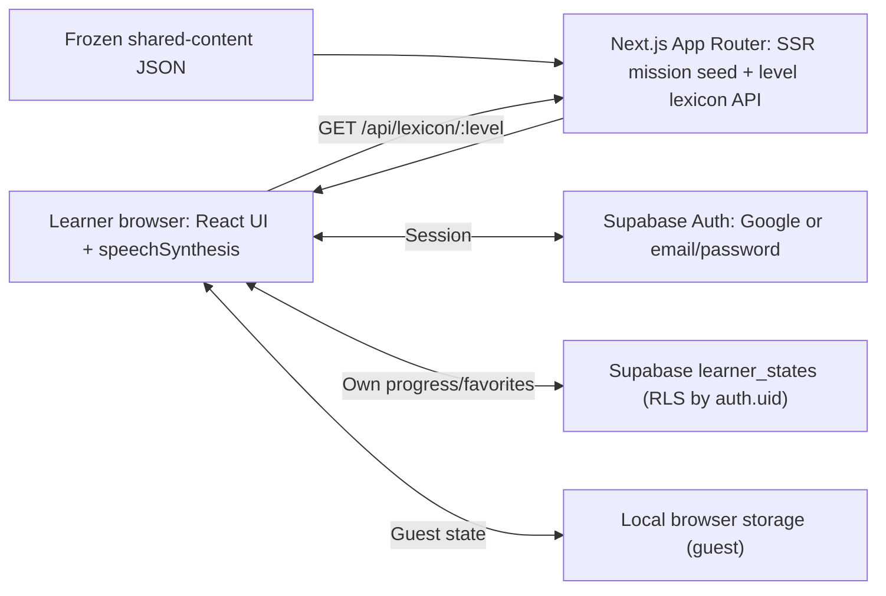

# Implementation Plan: Nordljud Classroom Swedish MVP

**Branch:** `condition/spec-driven` | **Date:** 2026-10-13 | **Spec:** [spec.md](./spec.md)  
**Input:** `specs/001-nordljud-classroom/spec.md`, [clarifications.md](./clarifications.md) and common dataset, without reading any Vibe/God Mode implementation source.

## Summary

Build an independent, user-focused Swedish learning web MVP: mission practice at four CEFR levels, a searchable 456-sense lexicon with preserved homographs, Swedish speech, Google/email authentication, and isolated per-user progress/favorites. Use explicit requirements and test coverage to guide every source file. No startup or scale-up features.

## Technical Context

- **Language/Version:** TypeScript 5.9, Node 22, React 19.
- **Primary Dependencies:** Next.js 15 App Router, `@supabase/supabase-js` 2.x.
- **Storage:** Frozen source JSON; browser localStorage for guests; authenticated per-user state in existing Supabase Postgres `learner_states` table (JSONB).
- **Testing:** Node native `node --test` for dataset invariants and pure data functions where practical; `tsc --noEmit`; `next build`; separate manual black-box acceptance.
- **Target Platform:** Browser (desktop and mobile) on Vercel Preview; Chrome or Firefox audio availability varies.
- **Project Type:** Educational web app.
- **Performance Goals:** Avoid initial transmission of all 1,824 lexicon records; fetch only the chosen level; simple target one mission per CEFR level.
- **Constraints:** No server-side secrets to browser, no modified shared teaching data, source record count 456/level, data isolation, Google OAuth externally configured.
- **Scale/Scope:** University MVP for comparison, not a production startup.

## Constitution Check — Gate 1 (before design)

| Principle | Decision | Outcome |
|---|---|---|
| Requirements before source | `spec.md` and `clarifications.md` committed before planning | PASS |
| Source fidelity | Keep shared JSON immutable; treat 456 entries / 455 spellings accurately | PASS |
| Auth isolation | Use Supabase RLS and condition-specific JSONB key | PASS by design; live test pending |
| Testable stories | 20 FR IDs and measurable acceptance scenarios | PASS |
| Simplicity | Four missions only; no monetization/AI tutor | PASS |

## System Architecture



- The server derives four missions from the immutable teaching input with deterministic question choices.
- Interactive page owns mission selection, dropdown for CEFR lexicon view, selected sense ID, correctness feedback and auth session.
- Level-specific endpoint sends exactly one 456-record dataset per request.
- A small `LearnerState` object holds mission flags and favorite sense IDs; guest and signed-in state never merge automatically.

## Project Structure

```text
.specify/                       # Real initialized official GitHub Spec Kit v1.1.3
specs/001-nordljud-classroom/
  spec.md
  clarifications.md
  research.md
  plan.md
  data-model.md
  quickstart.md
  contracts/lexicon-api.md
  tasks.md
  analyze.md
  converge.md                 # only after implementation and audit
app/
  layout.tsx
  page.tsx
  experience.tsx              # Independent SDD interactive UI
  globals.css
  api/lexicon/[level]/route.ts
src/
  domain.ts                   # Typed learning domain and identity
  teaching.ts                 # Derive four mission screens from frozen records
  supabase.ts                 # Public browser Supabase client
tests/
  source.test.mjs             # Ground-truth dataset and sense tests
.github/workflows/
  sdd-speckit-bootstrap.yml   # Real CLI setup evidence, already run
  sdd-check.yml               # Implementation tests
```

## API and Interfaces

See [lexicon-api.md](./contracts/lexicon-api.md). Query `GET /api/lexicon/A2` returns 456 source entries; invalid levels return 404. Server does not expose learner data. Supabase SDK does user-authenticated SELECT/UPSERT with RLS.

## Error and Privacy Strategy

- Display unsupported levels as 404, missing examples as unavailable, speech failure as a visible notification.
- Authentication flow preserves existing navigation if possible, returns to app origin, and presents OAuth/confirmation errors.
- Guest state remains in browser; signing in loads only the account's own state.
- Before every update to `learner_states`, read current JSONB and merge only our namespace, avoiding writes to other applications' state.
- Never transmit service-role keys or custom Google client secret in browser.
- Prevent multiple rapid user actions while a save is pending; report save errors.

## Verification and Traceability

| Requirement IDs | Planned evidence |
|---|---|
| FR-001–FR-007 | Source-seed test + mission UI/manual response/audio |
| FR-008–FR-011 | 456×4 dataset test, both `sticka` meanings, change-level selection, Favorites UI |
| FR-012–FR-015 | Real user sign-in, refresh, wrong password, two-account isolation; provider config limitations explicit |
| FR-016–FR-018 | Browser guest storage, errors, narrow viewport |
| FR-019–FR-020 | Source secret audit + compare condition branches |

## Project Management and Quality Gates

Gate 2 (**post-plan**): reconsider constitution against the concrete architecture; no exceptions identified.  
Gate 3 (**pre-implement**): generate ordered task list and `analyze.md` coverage check; no source code until this gate.  
Gate 4 (**post-implement**): automatic CI, actual Vercel Build, manual browser acceptance, `converge.md` with gaps.  
Avoid converting a requirement to a PASS without a reproducible test.

## Complexity Tracking

No constitutional violations requiring waiver. Uses existing table rather than new auth backend. No separate data warehouse, task queues, realtime subscriptions, analytics or payment infrastructure.

**Constitution Check — Gate 2:** Design matches the ratified constitution; **PASS (design-only)**. Provider/login and data-isolation checks remain execution-time obligations.
